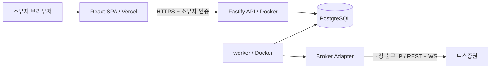

# 아키텍처

## 1. 배포와 책임



이 그림은 목표 운영 아키텍처다. 현재는 localhost 전용 읽기 전용 대시보드를 제공한다. API는 공개 worker entrypoint를 자식 프로세스로 실행하여 Node IPC로 snapshot을 수신하고 메모리 캐시만 브라우저에 제공한다. 기본 dev는 API와 web을 실행하며, CLI `broker:check`/`broker:sync`도 유지한다. 실제 매매는 실행하지 않는다.

web은 상태 조회와 운영 명령의 UI다. API는 인증·입력 검증·DB 조회·명령 기록을 담당한다. worker는 시장 데이터, 전략 평가, 리스크 검증, 주문 실행, 체결 대사를 담당한다. API와 worker는 독립 실행 파일이지만 같은 저장소·DB를 사용하는 모듈형 애플리케이션이며 마이크로서비스로 분할하지 않는다.

Vercel에는 SPA만 배포한다. 상시 루프와 WebSocket은 Docker worker에 둔다. 토스는 허용 IP를 확인하므로 broker 통신의 출구를 고정한다. API가 향후 토스 조회 결과를 요청받으면 DB snapshot을 반환하거나 worker에 작업을 기록한다. API와 worker가 각각 토큰을 발급하지 않는다.

## 2. 디렉터리와 의존성

```text
apps/
  web/                    React + Vite, app/pages/shared
  api/                    Fastify, health와 서버 설정
  worker/                 대기 프로세스, 읽기 전용 확인·수집 명령
packages/
  contracts/              Zod 계약, 시장·통화 타입, 안전 설정
  broker/                 공통 읽기 전용 port, toss adapter; Paper는 미구현
  trading/                시장 데이터 검증·이동평균 전략·백테스트; 향후 risk/execution
  database/               Drizzle 시세 저장·advisory lock·기본 스키마
docs/
  TOSS_API.md              공식 API 조사와 근거
infra/
  docker-compose.yml      로컬 PostgreSQL
  Dockerfile              API/worker 공용 빌드
```

처음 제안한 9개 도메인 패키지 대신 공통 4개 패키지로 시작한다. `packages/trading` 내부에 market-data, strategy, risk, execution, backtest 책임을 유지한다. 현재 순수 시장 데이터 검증·이동평균 교차·백테스트 엔진을 제공하며, worker가 동결 입력과 리포트 파일 I/O를 조립한다. risk/execution 원장은 후속이다. 토스 adapter는 `broker/src/toss`에 구현하고 `@hth/broker/toss`로 공개한다. 독립 배포·외부 재사용·의존성 격리가 실제로 필요해질 때 별도 패키지로 추출한다.

```text
web → contracts
api → contracts, worker (공개 IPC 실행 entrypoint)
worker → contracts, broker, database
broker → contracts
trading → contracts
database → contracts
contracts → zod
```

현재 앱은 실제 사용하는 의존성만 선언한다. 위 그림은 허용되는 방향이며 모든 연결이 구현되었다는 의미가 아니다. 전략은 broker·database를 import할 수 없다. 실행 계층은 worker에서 broker port와 DB repository를 주입받는다. 순수 도메인과 I/O의 연결은 앱 조립 지점에서 수행한다.

## 3. 주요 기술 선택

| 기술                      | 역할·선택 근거                                                    |
| ------------------------- | ----------------------------------------------------------------- |
| Node.js 24 LTS / pnpm 10  | API·worker 공통 런타임과 workspace, 단일 lockfile                 |
| React / Vite              | SPA에 필요한 빠른 개발·정적 빌드, 별도 SSR 런타임 불필요          |
| TypeScript 5.9 strict     | 도구 호환성이 검증된 버전으로 시작; 메이저 업그레이드는 별도 검증 |
| Fastify                   | HTTP lifecycle·구조화 로깅·주입 테스트 제공                       |
| Zod                       | 외부 입력·환경변수·공유 JSON 계약 검증                            |
| PostgreSQL / Drizzle / pg | 트랜잭션·행 잠금·제약 기반 정합성, SQL 기반 마이그레이션          |
| Tailwind CSS v4           | 초기 화면 스타일과 향후 shadcn/ui 기반                            |
| Vitest                    | 순수 함수와 Fastify inject 테스트, 실제 API 없이 검증             |
| ESLint / Prettier         | 타입 import, 레이어 방향·순환 의존·포맷 검증                      |
| tsx                       | 개발 시 TS 실행; 운영은 tsc 산출물의 Node.js 실행                 |

TanStack Query v5는 조회 캐시·오류·새로고침 상태, Lightweight Charts는 캔들 표시, `decimal.js`는 80자리 정밀 자산 계산에 사용한다. shadcn/ui와 Zustand는 실제 공용 UI·복잡한 로컬 상태가 생길 때 추가한다. Redis/BullMQ/Turborepo는 도입하지 않는다. 로컬 조회 worker는 기존 PostgreSQL 잠금을 사용하며 API의 중복 새로고침은 메모리 single-flight로 제한한다. 이 IPC 구성을 분산 durable 작업 큐로 간주하지 않는다.

## 4. worker와 인증 소유권

읽기 전용 명령은 client ID hash로 PostgreSQL advisory lock을 전용 DB connection에서 유지한다. 다른 프로세스가 먼저 잠금을 얻으면 인증 전에 실패하고, 연결 상실은 transport 취소 신호로 전달한다. 같은 client ID의 모든 프로세스가 동일 DB를 사용해야 한다. 미래 주문 worker는 추가 fencing token/lease와 주문 상태 compare-and-set이 필요하다. 현재 잠금이 실거래의 exactly-once 보장이라고 주장하지 않는다. 단순 interval 중복 실행을 매매 스케줄러로 사용하지 않는다.

토스 token manager는 worker 한 곳만 소유한다. `expires_in`으로 유효기간을 계산하고 만료 전 안전 여유를 두어 단일 갱신(single-flight)한다. 재발급 실패 시 신규 작업을 차단한다. API는 token을 저장하거나 갱신하지 않는다. 복수 worker로 확장할 때 발급 락과 안전한 공유 저장소를 설계한다.

## 5. 프론트엔드 경계

`src/app`은 Query Provider·전역 스타일·앱 조립, `src/pages`는 화면 단위 slice, `src/shared`는 범용 UI·환경설정·경로다. 앱 간 계약 패키지는 `@hth/contracts`로 명명해 앱 내부 shared와 구분한다. 같은 slice 내부는 상대경로, 다른 레이어는 alias를 사용한다. 서버 상태는 TanStack Query v5로 관리하고 차트는 client에서 지연 로딩한다. 공개 환경변수 `VITE_*`에는 비밀을 넣지 않는다. 브라우저는 Vite `/api` 프록시를 통해 Fastify와 통신한다.

현재 개발용 대시보드는 loopback IP·허용 Host/Origin·Sec-Fetch-Site를 검사하고 변경 요청에 전용 헤더를 요구한다. production 또는 공개 bind에서는 활성화를 거부한다. 로컬 OS 사용자만 신뢰하며 사용자별 로그인은 아직 없으므로 이 경계를 인터넷 인증으로 대체 해석하지 않는다. Vercel 배포 전에 OIDC/세션·TLS·외부 프록시를 구현한다.

## 6. 운영·보안

운영 시 web origin을 정확하게 허용하고, 별도 API 도메인에 소유자 인증을 적용한다. UI 숨김은 권한 통제가 아니다. Vercel preview는 실제 계좌 데이터 및 live backend에서 격리한다. DB는 public port를 노출하지 않고 private network에서 사용한다. 현재 Compose의 localhost DB 포트는 로컬 개발 전용이다.

로깅은 request ID, 내부 식별자, 허용 목록의 오류 코드 중심이다. querystring·body·Authorization·계좌 헤더를 통째로 기록하지 않는다. 감사 기록에는 설정 변경자·시각·전후 상태와 정규화된 실패 원인을 저장한다. 민감 데이터 원문은 저장하지 않는다.

## 7. 참고 자료

- [Vite의 Vercel 배포와 SPA rewrite](https://vercel.com/docs/frameworks/frontend/vite)
- [Vercel 모노레포 Root Directory 설정](https://vercel.com/docs/monorepos)
- [Vercel Functions의 실행 시간 제한](https://vercel.com/docs/functions/limitations)
- [토스 공식 조사 및 원문 링크](docs/TOSS_API.md)
