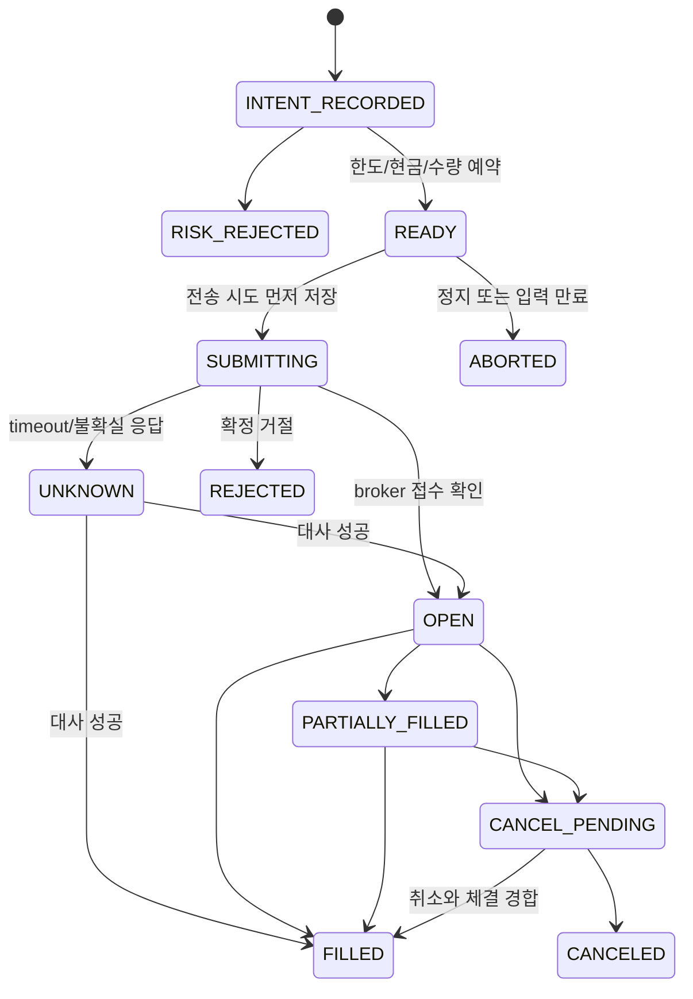

# 상세 설계

이 문서는 도메인의 계약과 불변조건을 정의한다. 현재 공통 계약·읽기 전용 Toss adapter·시세 수집과 동결 저장·이동평균 교차 백테스트·로컬 대시보드와 리포트 비교를 제공한다. 아래 주문 상태 머신과 위험 검증은 아직 실행 코드가 아니다.

## 1. 데이터·시간·통화

가격·금액·수량은 API JSON에서 십진 문자열, PostgreSQL에서 `numeric(30, 10)`으로 저장한다. 정밀 계산 시 decimal 라이브러리를 사용하고 JS `number` 변환으로 계산하지 않는다. 비율의 단위는 소수 비율, 리포트 표시는 별도 변환한다. KRW/USD는 타입과 컬럼으로 구분하며 통화가 다른 값을 직접 합산하지 않는다.

전체 자산의 KRW 평가는 timestamp·source가 있는 환율로 환산한다. 환율이 만료되면 통합 평가와 환율 의존 위험 검증을 실패 처리한다. USD 매수는 USD 매수가능금액으로 검사한다. API는 자동환전을 제공하지 않는다.

모든 event time은 UTC ISO 8601/timestamptz, 거래일은 시장 현지 `date`로 유지한다. 표시·일일 손실 집계 기준은 KR=`Asia/Seoul`, US=`America/New_York`. 고정 UTC 오프셋을 사용하지 않는다. 국내는 KRX/NXT 통합 데이터이며 거래소별 분리가 가능하다고 가정하지 않는다.

캔들 키는 `(market, symbol, interval, timestamp, adjusted, source)`다. API의 최신순 데이터를 시간 오름차순으로 정규화하고 중복 페이지를 제거한다. `before`는 inclusive이므로 응답 `nextBefore`를 사용한다. 진행 중 봉, 누락·역순·비정상 OHLC를 전략에 그대로 전달하지 않는다. 미국 늦은 체결에 의한 과거 봉 변경은 수집 revision과 backtest dataset version으로 구분한다.

`1m` timestamp는 봉 종료 시각이다. `1d` timestamp는 세션 종료가 아니므로 시장 캘린더에서 완료 여부를 판단한다. 국내 일부 마감 봉은 이후 시간외 체결로 변경될 수 있으므로 확정 대기와 재수집 정책이 필요하다. 미국 무체결 분은 누락될 수 있고 국내 거래량 0 봉은 정상일 수 있다. WebSocket tick 합산만으로 정확한 캔들을 재구성하지 않는다.

현재 세션·60초 대기·재수집 증거에 따른 종료 판정과 실시간 전략 입력 신선도 게이트를 구현했다. 국내 NXT 미지원 정규장 마지막 봉은 최소 16:01 KST 이후 재수집한다. 정상 데이터도 제공 원천의 과거 변경 가능성이 있으며 종료 판정은 불변 확정이 아니다. 상세 임계값과 차단 사유는 [시장 데이터 정책](docs/MARKET_DATA_POLICY.md)에 정의한다. revision·동결 데이터셋 저장과 hash 검증은 구현했다.

## 2. 전략·백테스트

Strategy는 버전·설정과 닫힌 캔들·해당 전략 소유 수량을 입력받아 BUY/SELL/HOLD 신호를 반환한다. HTTP·DB·현재 시스템 시각·broker를 참조하지 않고 평가 시각을 입력받는다. 신호는 주문이 아니며 주문 크기는 별도 sizing 정책에서 결정한다.

이동평균 교차는 `shortWindow < longWindow`를 검증하고 과거/현재 완성 봉의 두 평균 관계가 교차할 때만 신호를 낸다. warm-up이 부족하면 HOLD, SELL은 자동매매 소유 수량에만 적용한다. 동일 strategy run·symbol·bar·signal 키를 재사용해 중복 신호를 제거한다.

백테스트는 시각 t까지의 prefix만 전략에 전달하고 t에서 생성한 신호는 가장 빨라도 다음 봉 시가에 체결한다. 마지막 봉 신호는 체결하지 않는다. 수수료·세금·슬리피지는 방향·시장별 매개변수다. 현금 부족·호가/수량 단위·거래 세션·자금 예약을 반영하고 체결 가정을 리포트에 남긴다.

현재 MVP는 이동평균 교차와 단일 종목·정수 수량·무차입 long-only의 `next-eligible-open-v1`을 구현했다. 신호는 종료 증거의 usableAt에서 평가하므로 다음 봉이 이미 시작했다면 그 이후 시가까지 기다린다. 현금 부족·중복 매수·수량 없는 매도를 차단하며 고정 tick과 비용 가정을 명시한다. 실제 유동성·거래 정지·시장별 변동 tick·예약 원장·기업행위 현금 흐름은 아직 반영하지 않는다. 동결 데이터셋 증거를 재검증하고 JSON 성과 리포트를 생성한다. [구현 범위와 지표](docs/BACKTESTING.md)

수익률은 초기 자산 대비 비용 차감 순자산, MDD는 시간별 순자산의 고점 대비 최대 하락 비율, 승률은 청산 완료 거래 중 순손익 양수 비율, 거래 횟수는 완료 round-trip 수로 정의한다. 주문 수/체결 수는 별도 지표다. 미청산 포지션은 마지막 유효 가격으로 평가하되 강제 청산을 암묵적으로 추가하지 않는다. 초기자산 0·거래 0·손익 0인 경우의 분모 처리도 테스트한다.

분할·배당, 일부 미국 거래소 기반 시세, 상폐 종목 미지원에 따른 생존편향, 수정주가 제공 전 구간의 한계를 결과에 표시한다. `adjusted`와 입력 데이터 버전·전략 버전·비용·난수 seed를 저장한다. 조정 데이터와 실제 체결 가격을 혼용하지 않는다.

## 3. 리스크와 기존 보유분 보호

현재 `evaluatePaperRisk`는 명시적 입력으로 Paper 한도·원장 정합성·미체결 잔량·소유권과 데이터 신선도를 검증한다. `initialPaperControl`/`stopPaperControl`과 epoch·snapshotVersion·유효시간 재검사를 제공한다. 리스크 계산은 순수 함수이며, 별도 Paper repository가 잠금 안의 DB 예약·정지 영속화와 모의 체결에 연결한다. `canReserve`를 주문 승인으로 사용하지 않는다. [Paper 리스크 계약과 합성 검증](docs/PAPER_RISK.md)을 따른다.

검증 순서: 실행 권한/긴급 정지 → worker 소유권 → 데이터·계좌·세션 신선도 → 시장/종목 거래 가능 여부 → 전략 활성 여부 → 한도·중복 → 현금/소유 수량 예약. 하나라도 불확실하면 신규 주문을 거부한다. 종목/일일 한도는 DB transaction과 행 잠금으로 동시 예약까지 합산한다.

초기 위험 설정은 미정으로 취급하여 주문을 차단한다. 1회 금액, 종목별 누적 노출, 일일 손실(실현+미실현, 수수료 포함), 최대 보유 종목 수, 미체결 매수와 예약금을 포함한 중복 매수를 검사한다. 한도 기준 통화와 시장 현지 일자를 명시한다. 외부 입출금과 수동 거래는 전략 수익률에서 분리한다.

소유권 원장은 `(account, mode, strategyRun, market, symbol)` 단위다. 첫 계좌 snapshot의 기존 수량은 모두 `manual`로 분류하고 자동 편입하지 않는다. 자동 소유 수량은 추적 가능한 시스템 주문 체결로만 증가한다. 매도 가능량은 broker 판매가능수량과 자동 소유량에서 미체결 매도 예약을 뺀 값의 최솟값이다. 수동 매도로 대사가 어긋나면 해당 종목을 차단하고 운영자가 확인한다.

긴급 정지는 DB의 지속 설정이며 기본 true다. 정지는 신규 주문 차단을 뜻하며 기존 포지션의 시장가 청산을 뜻하지 않는다. 미체결 취소는 별도 정책과 실패 추적을 적용한다. DB 접근 실패 시 정지 여부를 확인할 수 없으므로 신규 주문을 차단한다. 설정 epoch를 예약 시와 외부 전송 직전에 확인하고, 정지와 전송 경합은 단일 실행 경로로 직렬화한다. 이미 전송된 요청은 정지 후에도 체결될 수 있음을 UI에 알린다.

## 4. 주문 의도·상태·대사

현재 Paper 전용으로 INTENT_RECORDED·READY·PARTIALLY_FILLED·FILLED·RISK_REJECTED·ABORTED와 영구 dedupe, 계좌 행 잠금 안의 리스크 재평가·예약/해제·정지·worker lease·복구 확인을 구현했다. 내부 합성 체결은 현금·전략 소유권·원가·누적 비용과 잔량을 함께 반영한다. [Paper 실행기](docs/PAPER_WORKER.md)가 단일 lease·heartbeat·원장 복구·관측 손익·순차 tick을 합성 데이터로 검증한다. [체결 정책](docs/PAPER_FILLS.md)을 따른다. [Paper 원장](docs/PAPER_LEDGER.md)을 따른다. 아래 SUBMITTING 이후 전송·체결·대사는 아직 구현하지 않았다.

도표는 주요 경로다. 정정·취소 실패는 요청 attempt의 결과로 기록하며 원주문을 거절 상태로 바꾸지 않는다. 정정은 새 broker ID가 생길 수 있어 parent/child 연결과 수량 예약 이전을 유지한다. 종료 상태에도 누적 체결 증가가 확인되면 broker 근거로 보정 이벤트를 추가한다. 상태 문자열의 크기 비교나 무조건적인 terminal 덮어쓰기를 금지한다.

1. 전략 평가 키와 주문 의도를 DB unique 제약으로 먼저 기록한다.
2. 리스크 검증과 예약을 transaction으로 완료한다. HTTP 통신 동안 DB transaction을 유지하지 않는다.
3. 단일 worker가 version compare-and-set으로 의도를 claim하고 `SUBMITTING`과 attempt를 commit한 뒤 전송한다.
4. broker ID·상태·누적 체결을 기록한다. 불확실하면 `UNKNOWN`으로 남겨 동일 종목의 신규 실행을 차단한다.
5. WebSocket 주문 이벤트와 REST snapshot으로 대사한다. 누적 체결량 차이만 원장에 반영해 중복 반영을 막는다. 누적 평균 체결가 변경 시 누적 체결대금의 차이로 원가를 보정한다.

`clientOrderId`는 내부 영구 중복 키와 별개다. 토스의 멱등성 보장은 10분에 한정되므로 자동 재전송을 기본 금지한다. future implementation에서 동일 요청/동일 키/보장 기간 내 재시도를 허용하려면 별도 검증된 정책을 추가한다. 기간 초과·broker ID 미확인·응답 누락 시 수동 검토까지 보류한다. 새 키를 만들어 재시도하지 않는다.

재시작 시 신규 전략 실행을 먼저 막고, 열린 의도·예약·UNKNOWN·OPEN·부분 체결을 복구한다. broker OPEN 전량과 CLOSED pagination을 조회하고 주문 상세·보유수량·현금과 대사한 뒤 재개한다. REST 체결 내역은 개별 fill이 아닌 주문별 누적값이다. 끊긴 WS 구간을 개별 fill로 복원할 수 있다고 가정하지 않고 복구분은 reconciliation adjustment로 출처를 남긴다. 외부 앱 주문을 시스템 주문으로 자동 편입하지 않는다.

Paper 대시보드는 `docs/PAPER_DASHBOARD.md`의 localhost·테스트 DB 경계와 고정 계좌 DTO를 따른다. 조회는 자원/제어를 변경하지 않는다. 정지는 먼저 커밋된 제어 epoch로 이후 실행을 무효화하며 이미 체결한 보유분은 보존한다. UI 응답을 잔량 정리 완료로 해석하지 않는다.

소유자 인증은 `docs/OWNER_AUTH.md`의 단일 서버 cookie 세션을 따른다. 전략 변경은 `docs/STRATEGY_SETTINGS.md`의 per-strategy revision CAS와 불변 이력을 사용하며 계좌 정지/epoch를 함께 커밋한다. 저장 정의와 신호의 revision/hash를 예약·체결에서 검사한다. 비활성/재활성으로 동일 봉 중복 키를 바꾸지 않는다.

전략 이력은 서버 고정 계좌의 읽기 전용 snapshot에서 현재 조건과 함께 조회한다. 리비전 cursor로 최대 20개씩 읽고 내용 hash·연속성·현재 조건과 최신 이력의 연결을 검증한다. 화면 비교는 미등록 값을 보존하며 복원·재개를 수행하지 않는다. [조회 정책](docs/STRATEGY_HISTORY.md)을 따른다.

## 5. DB 스키마 계획

| 테이블                                   | 주요 데이터와 제약                                  | 현재 상태   |
| ---------------------------------------- | --------------------------------------------------- | ----------- |
| instruments                              | market+symbol unique, currency, name                | 기본 스키마 |
| candles                                  | 복합 unique, OHLCV, 수집시각, adjusted, source      | 기본 스키마 |
| candle_revisions                         | 정규화된 값 hash, 원본 가격 추가 이력, 변경 차단    | 구현        |
| historical_datasets                      | 관측·캘린더·종료 증거·선택 봉, content hash         | 구현        |
| paper_accounts / paper_strategies        | Paper 잔고·소유권, 정지/lease/한도, 전략 활성       | 구현        |
| paper_order_intents / paper_reservations | 영구 신호 키·불변 요청·상태, 원자적 예약/해제       | 구현        |
| paper_events                             | Paper 제어·예약·거부·복구 감사 이력, 변경 차단      | 구현        |
| paper_fills / paper_cost_basis           | 불변 체결 키·비용·실현 손익, 전략별 잔여 수량/원가  | 구현        |
| accounts / cash_snapshots                | broker 계좌 참조, mode·currency별 잔고·수집시각     | 설계        |
| strategy_runs                            | 전략/버전/설정, 활성화, 실행 mode                   | 설계        |
| signals                                  | 전략·종목·봉·신호 unique                            | 설계        |
| order_intents / order_attempts           | 영구 dedupe key, 상태/version, 요청 hash, broker ID | 설계        |
| order_events / executions                | broker 누적량·대금·수수료, 이벤트 중복 키           | 설계        |
| position_ownership / reservations        | 수동/자동 소유권, 예약 수량·현금, strategyRun       | 설계        |
| trading_controls / risk_limits           | singleton 긴급 정지, epoch, 기본 true, 통화별 한도  | 설계        |
| market_sessions / fx_rates               | 거래일·세션·source·timestamp                        | 설계        |
| backtest_runs / equity_points            | 버전·설정·비용·지표와 곡선                          | 설계        |
| audit_events / worker_leases             | 실패·설정 변경·heartbeat·독점 실행                  | 설계        |

Paper와 Live 원장은 모든 unique key에서 mode로 분리한다. API 토큰·client secret은 이 업무 스키마에 저장하지 않는다. 추후 토큰을 영속화할 경우 암호화·접근 제한·발급 소유권을 별도로 설계한다. 마이그레이션은 검토 후 배포 작업으로 수행하며 서버 시작 시 자동 적용하지 않는다.

## 6. API·인증·장애 정책

백테스트 리포트는 `GET /v1/backtests`, `GET /v1/backtests/:hash`로 조회한다. API가 고정 `.local-data` 디렉터리의 지원 schema·SHA-256 검증본만 제공하며 파일 경로를 입력받지 않는다. localhost 개발 서버에서만 저장소를 구성하고 production·public bind는 비활성화한다. 목록은 5초 색인, 상세는 매번 재검증하며 파일·누적 읽기 상한을 둔다. 웹의 비교는 같은 데이터셋·통화·초기 자산일 때만 곡선을 겹친다. [리포트 조회의 범위와 한계](docs/BACKTESTING.md)를 따른다. 실행·주문 endpoint는 추가하지 않았다.

현재 endpoint는 `GET /health/live`, `GET /v1/dashboard`, `POST /v1/dashboard/refresh`다. health는 프로세스 생존만 의미한다. dashboard는 localhost 개발 전용으로 키·계좌 식별자를 제외한 snapshot을 제공하고 no-store를 설정한다. 새로고침은 worker를 fork하여 실제 데이터를 한 번 조회하며 DB 저장이나 거래를 수행하지 않는다. 토스 호출은 최소 30초 간격, API 메모리 조회는 브라우저에서 3초 polling한다. 실패 시 과거 데이터와 오류를 함께 유지한다. mode=paper, executionEnabled=false를 명시한다. 개발용 loopback·Host·Origin 차단은 구현했지만 인터넷 소유자 인증은 아직 없다.

향후 `/v1/accounts`, `/v1/strategies`, `/v1/orders`, `/v1/backtests`, `/v1/trading-controls`를 내부 API 후보로 사용한다. 아직 확정 HTTP 계약이 아니며 토스 endpoint와 구분한다. 인증은 OIDC 소유자 subject allowlist와 서버 세션을 검토한다. cookie 방식은 Secure/HttpOnly와 배포 도메인에 맞는 SameSite, CSRF token·Origin 검증이 필요하다. 서로 다른 site의 인증 쿠키 제한은 custom domain 구성으로 해결할지 Phase 4에서 확정한다.

조회의 429는 `Retry-After`와 jitter를 준수하고 그룹별 limiter를 사용한다. 조회의 일시적 5xx·네트워크 실패는 상한 있는 재시도, 401은 token manager를 통한 단일 재발급, 403·검증 오류는 자동 재시도하지 않는다. 주문 timeout·5xx는 단순 재시도 대상이 아니다. broker 오류 전문 대신 안전한 오류 코드·request ID를 기록한다.

실거래는 현재 환경 스키마에서 거부한다. Phase 5에는 서버 live 허용 설정과 인증된 운영자의 계좌·금액·기간에 제한된 활성화 승인을 모두 요구한다. 키·환경변수 하나만으로 활성화하지 않고 재시작 시 승인 만료/계좌 대사 완료 전까지 정지한다.

## Paper 계좌 출처

계좌 생성 시 `data_source`에 synthetic-only/toss-readonly를 명시하고 이후 변경하지 않는다. 미지정/과거 계좌는 unverified로 보존하며 마이그레이션이 정지·새 epoch·감사 이력을 기록한다. 자산/손실/주문 이력은 유지한다. DB 트리거는 출처/ID 변경·미확인 재개·다른 출처 의도 기록을 차단하고, worker lease/관측과 원장 의도/예약/체결도 일치 여부를 검증한다. source는 신뢰된 adapter/실행 구성의 식별이며 시세 진위의 암호학적 증명은 아니다.

API 서버는 synthetic/market 종류와 한 테스트 DB/계좌를 선택한다. DB와 설정의 출처가 어긋나면 조회/편집을 차단한다. 미확인 계좌는 조회/정지만 허용하며 기존 출처를 소급 변경해 실행하지 않는다. 새 별도 계좌로 검증하고 자산을 자동 이관하지 않는다. [화면/업그레이드 절차](docs/PAPER_DASHBOARD.md)를 따른다.

휴장 중에는 검증된 세션으로만 대기 여부를 판단하며 예약 정리·정지/epoch와 평가 생략을 함께 적용한다. 개장 후에도 자동 재개하지 않는다. 장시간 중단 후 일일 기준 검토는 만료된 계획/version·lease/epoch·신선한 전체 quote를 검사하고, 지난 거래일의 손실을 새 평가 차이와 함께 이월한다. 이전 이익으로 새 손실 한도를 늘리지 않는다. 검토 성공도 정지 상태이며 자산 소유권과 현금/수량을 변경하지 않는다. [세션과 검토 절차](docs/PAPER_SESSIONS_REVIEW.md)를 따른다.

운영 전 데이터 검증은 [읽기 전용 시세 관측](docs/MARKET_OBSERVATION.md)으로 수행한다. `assessMarketData`는 계좌를 가정하지 않는 시장 품질 검사이며 기존 `prepareStrategyData`의 계좌/신선도 검사는 유지한다. 관측 루프는 주문·원장 변경 없이 제한된 메타데이터를 journal에 저장하고 종목별 상태/지연과 실행 오류를 요약한다. 완료 상태를 매매 승인으로 사용하지 않는다.

관측 리포트 API/화면은 고정 루트의 UUID 실행만 읽고, strict 계약·journal 해시·순서·종목 집합과 재집계 결과를 검증한다. 완료·실패·미완료를 분리하고 조회로 수집이나 매매를 시작하지 않는다. 파일/스캔 상한과 소유자/로컬 접근 경계는 [관측 문서](docs/MARKET_OBSERVATION.md)를 따른다.

대시보드 관심종목은 전략·보유분·수집 CLI와 분리한 서버 설정이다. 키/업무 DB 없이 편집할 수 있도록 `.local-data/settings`에 잠금·revision CAS·원자적 교체로 저장한다. 저장 확인 시 전체 조회 snapshot과 진행 중 요청을 무효화하고 명시적 새로고침으로만 반영한다. 빈 목록을 보존하고 늦은 응답을 폐기한다. [상세 범위와 복구](docs/WATCHLIST.md)를 따른다.
