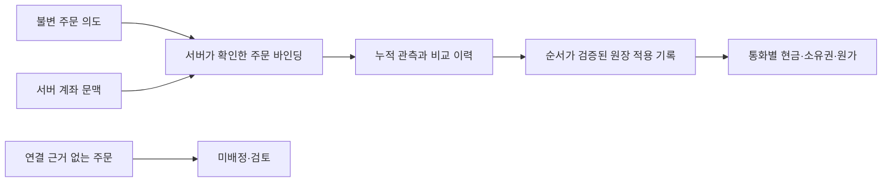

# 주문 의도·계좌·전략 소유권과 체결 원장 연결 설계

2026-11-12. **설계 결정이며 구현/운용 승인이 아니다.** 현재 live 설정 거부와 실제 주문 생성·정정·취소 금지를 유지한다. 이번 작업은 문서만 변경하며 DB/마이그레이션·broker·Paper·worker 실행·계좌 연결을 수행하지 않는다.

## 1. 현재 코드에서 확인한 차이

| 기존 구성                                                                                  | 보장하는 범위                                         | 바인딩/실제 원장에 부족한 부분                                                  |
| ------------------------------------------------------------------------------------------ | ----------------------------------------------------- | ------------------------------------------------------------------------------- |
| [주문 조회](ORDER_READONLY.md)·[관측 계약](../packages/contracts/src/order-observation.ts) | 계좌 문맥에서 얻은 주문을 공통 누적 값으로 표현       | 전략/내부 의도 연결을 응답에서 인증하지 않음. scope hash는 소유권 증명이 아님   |
| [순수 대사](ORDER_RECONCILIATION.md)                                                       | 두 관측의 일치·증가·모순을 계산                       | 개별 체결 ID·소유권·기록의 진위·원장 적용 권한을 만들지 않음                    |
| [합성 저장소](ORDER_REVIEW_STORE.md)·[유한 세션](ORDER_REVIEW_SESSION.md)                  | 합성 요청의 영구 중복 키·CAS·이력·중단/재연결         | 계좌/의도 FK와 금융 원장 없음. testing 경로·합성 source 전용                    |
| [Paper 원장](PAPER_LEDGER.md)·[체결](PAPER_FILLS.md)                                       | 의도 선기록·계좌 잠금·예약·모의 체결·전략 소유권/원가 | quote-proxy-v1·추정 비용·즉시 매도 가능 가정. 실제 누적 체결용 회계 모델이 아님 |

[현재 스키마](../packages/database/src/schema.ts)의 paper_fills는 quote-proxy-v1, 양의 정수 수량/체결가, `notional = price × quantity`, 음수가 아닌 비용을 요구한다. 실제 누적 관측의 차이·수수료 환급·정산을 이 테이블에 넣거나 맞추기 위해 체결가를 만들어내지 않는다. 기존 Paper 제약을 느슨하게 바꾸는 방식도 채택하지 않는다.

## 2. 결정: 의도→주문 바인딩→관측→원장 적용

하나의 TypeScript/PostgreSQL backend 안에서 책임을 분리한다. 서비스·Redis·새 ORM을 추가하지 않는다. 순수 검사는 trading, strict JSON 계약은 contracts, DB 잠금/원자성은 database, 증거 수집/문맥 전달은 worker에 둔다. 전략 엔진은 broker/DB에 직접 의존하지 않는다.

기존 합성 order_review_*를 실제 계좌용으로 전환하지 않는다. 기존 Paper 계좌의 data_source=toss-readonly도 **시세 출처**이며 실제 주문/실계좌 원장이라는 뜻이 아니다. 실제 원장은 추후 별도 저장 영역·마이그레이션으로 설계/구현하고 기존 Paper 계좌·현금·신호 키·체결을 가져와 시작하지 않는다.

## 3. 바인딩의 신원과 불변 항목

서버가 관리하는 internal account ID가 기준이다. broker ID·환경·연결 세대·비공개 계좌 reference는 서버의 계좌 문맥에서 확인한다. 영구 계좌 namespace는 broker+환경+내부 계좌로 고정하며 토큰 갱신/프로세스 교체/연결 세대로 바꾸지 않는다. 연결 세대는 증거의 출처/현재 처리 권한 검사에만 사용한다. 브라우저·주문 응답에 들어온 scope/strategyId·요청자가 제출한 hash만으로 계좌를 선택하거나 권한을 부여하지 않는다. 비공개 계좌 reference와 토큰은 응답/일반 로그에 넣지 않는다.

한 바인딩은 다음을 고정한다.

- 내부 계좌 ID·영구 broker 계좌 namespace와 source 종류, 최초 연결 근거의 출처. 합성/실제 데이터의 namespace를 구분한다.
- 내부 intent ID·영구 signal/dedupe key·정규화 요청 hash.
- 소유 전략 ID·의도 생성 당시 전략 revision/정의 hash. 현재 최신 revision으로 과거 주문의 소유자를 바꾸지 않는다.
- 시장·종목·통화·방향·수량·주문 조건. 십진 값은 정규화된 경제값을 비교하고 optional의 누락/null은 보존한다.
- broker order reference와 이를 해당 intent에 연결한 근거의 종류/참조/hash.

보유분의 소유자는 계좌+시장/종목+전략 ID로 유지하고, 주문별 revision은 유입 경로의 이력으로 남긴다. 전략 revision이 바뀌어도 기존 수량/원가를 새 전략 또는 수동 소유로 재분류하지 않는다. 비활성화/삭제도 소유권 양도가 아니다.

고유 제약은 `(account, intent)` 한 바인딩, `(영구 broker 계좌 namespace, order reference)` 한 바인딩이다. 연결 세대가 바뀌어도 이 고유 범위와 기존 연결 근거는 바꾸지 않는다. 종료 후에도 키를 보존한다. 다른 계좌/전략의 동일 주문 연결, 같은 intent의 두 번째 주문, 새 UUID를 사용한 중복 연결은 거부한다. 현재 초기 범위는 의도 하나와 외부 주문 하나다. 정정으로 ID가 바뀌는 경우 parent/child 근거와 예약 이전 정책이 구현되기 전까지 새 바인딩으로 자동 연결하지 않는다.

### 무엇이 연결 근거가 되는가

추후 주문 전송 구현에서는 **먼저 커밋된 불변 의도/전송 attempt**와, 같은 계좌 문맥·같은 요청에 대한 접수 결과를 연결해야 한다. 응답에 제공되는 상관 식별자/조회 가능성/보장 기간은 그 별도 작업에서 공식 명세로 재확인한다. 현재 조회 adapter가 그런 증명을 제공한다고 가정하지 않는다.

종목·방향·수량·가격·주문 시각이 모두 같아도 연결 근거를 대신하지 않는다. 계좌 목록에 존재함, 상세 조회 성공, 주문 ID를 사람이 입력함, checksum 일치도 시스템이 만든 주문이라는 증거가 아니다. 수동/다른 채널 주문은 미배정 상태로 보존하고 전략 수량으로 편입하거나 자동 매도하지 않는다.

접수 응답이 불확실하고 신뢰할 상관 근거가 없으면 미확인으로 남긴다. 기존 주문을 추정 매칭하거나 새 ID로 재전송하지 않는다. 근거 없는 과거 주문에 의도를 사후 생성하지 않는다. 초기 가짜 입력 검사에서의 일치 판정도 실제 ownershipVerified를 true로 만들지 않는다.

## 4. 제안하는 저장 책임 — 아직 테이블을 만들지 않음

| 논리 레코드    | 불변/갱신 항목과 제약                                                                                 |
| -------------- | ----------------------------------------------------------------------------------------------------- |
| 계좌 제어/원장 | 내부 계좌 문맥·통화별 원장·version·정지/epoch·회계 처리 소유권. 모든 자원 변경의 계좌 행 잠금 기준    |
| 주문 의도      | 계좌·전략 revision·요청/신호 hash·영구 dedupe. 전송/바인딩보다 먼저 커밋                              |
| 전송 attempt   | 향후 별도 전송 작업의 영구 시도 키·불변 요청·접수 근거 또는 불확실 결과. 현재 생성/전송 안 함         |
| 주문 바인딩    | 계좌/의도와 외부 주문의 고유 연결·근거 hash·검토 상태·마지막 관측/적용 순서                           |
| 관측/대사 이력 | 순서·이전 hash·정규화 누적 값·알고리즘 version·판정·해당 바인딩. append-only                          |
| 원장 적용 기록 | 바인딩+관측 순서의 영구 고유 적용 키·이전 적용 hash·정확한 금액/수량 효과·원가/현금 변경. append-only |

계좌/의도/바인딩의 복합 FK로 계좌가 다른 객체 연결을 막는다. 해시의 참조 무결성과 source/계좌 문맥의 신뢰는 별개다. 삭제/재초기화로 키를 재사용하지 않으며 정상 앱에 연결되지 않은 설계안을 마이그레이션처럼 실행하지 않는다.

## 5. 관측 기준과 적용 기준을 따로 유지

관측을 저장한 성공과 금융 원장 적용 성공은 다른 사건이다. 비교 기준만 먼저 진행한 후 다음 delta부터 원장에 넣으면, 중간에 실패한 체결분이 영원히 누락된다.

- `lastObserved`는 저장/검증된 관측 이력의 끝이다. `lastApplied`는 금융 효과까지 커밋한 순서다.
- 새 관측을 저장해도 lastApplied는 바꾸지 않는다. 적용기는 다음 순서를 하나씩 소비한다. 0효과/metadata-only도 명시적 no-op 적용 기록으로 연결하고 순서를 몰래 건너뛰지 않는다.
- 고유 적용 키는 operation UUID나 이번 run ID가 아니라 **영구 바인딩 ID+관측 순서**다. 동일 관측의 재조회·새 세션·응답 유실로 효과가 두 번 생기지 않아야 한다.
- 이미 적용된 키는 저장 결과를 반환한다. replayed=true/false만 보고 증분을 더하거나, 새 키로 과거 receipt를 재적용하지 않는다.
- 보류/순서 공백/이력 변경은 다음 관측을 적용해 덮지 않는다. 알고리즘이 바뀌어도 과거 판정/금액을 몰래 재계산하지 않는다.

현재 합성 저장소에는 lastApplied가 없으며 이 설계의 금융 소비자로 사용하지 않는다. 첫 관측이 이미 부분 체결인 경우를 영(0) 기준으로 소급 처리하는 것도 현재 지원하지 않는다. 알려진 0 기준의 합성 흐름만 유지한다. 실제 최초 부분 체결의 기준 설정은 전송 전 원장/접수 근거와 미적용 잔액 전체를 증명하는 별도 정책이 필요하다. provider의 null 금액/비용은 그 정책에서도 0이 아니다.

## 6. 추후 적용 트랜잭션과 경합

아래는 향후 금융 적용기의 순서이며 현재 실행 경로가 아니다.

1. DB transaction에서 계좌 행 → 해당 intent → binding 순서로 잠근다. 복수 바인딩 작업이 필요하면 ID 정렬 순서를 고정한다. 네트워크 호출은 이 잠금 안에서 수행하지 않는다.
2. 같은 적용 키가 있으면 불변 요청/hash 일치 여부를 확인하고 기존 결과만 반환한다.
3. 서버 계좌 문맥/source·불변 의도/전략 소유자·바인딩 근거·전체 필요한 이력/순서·기대 account/binding version·정지 epoch와 현재 회계 처리 소유권을 검사한다. hash를 실행 권한으로 사용하지 않는다.
4. 마지막 적용 누적 값과 바로 다음 증거를 기준으로 효과를 산출한다. 계산/의미/정산 정책이 불충분하면 증거를 보존하고 미적용/검토로 남긴다.
5. 고유 적용 기록·통화별 현금/미정산 항목·전략 수량/원가·잔여 예약·계좌/binding version·lastApplied·감사 이력을 같은 transaction에서 커밋한다. 중간 실패는 전체 rollback이다.

미구현 상태인 구체 테이블·SQL 제약·정산 산술은 별도 코드 작업에서 검증한다. 현재 paper.fill을 이 순서의 대체재로 호출하지 않는다.

### 정지/전략 변경 이후 도착한 사실

새 주문 권한과 이미 발생한 체결의 회계 확인을 구분한다. 정지/lease 교체/전략 비활성화가 외부 주문 취소나 체결 소멸을 뜻하지 않는다. 이전 lease로 새 처리 권한을 얻지 못하지만, 현재의 별도 회계 처리 소유자가 기존 바인딩의 확정된 사실을 검토할 수 있어야 한다. 이 권한은 신규 주문·예약·재개 권한을 포함하지 않는다.

실제 사실의 누적량이 예약/한도를 초과했다고 가짜 주문 거절이나 미체결로 바꾸지 않는다. 근거가 확인된 계좌 수준 사실/의무는 손실 없이 보존하고 부족액·미배정 수량을 별도 검토 대상으로 남기며 신규 거래는 차단한다. 전략 소유권/원가를 확정할 수 없으면 그 부분은 미배정으로 남긴다. 실제 회계/미배정 처리가 구현되기 전에는 금융 적용기를 활성화하지 않는다.

현재 Paper의 lease·정지 해제·risk 검사를 이 설계로 우회하지 않는다. 실제 주문용 복구에서 Paper의 `abort`처럼 로컬 예약만 풀고 외부 주문이 끝났다고 간주하지 않는다. 취소 접수·목록 부재·404도 취소/잔량 해제의 충분한 근거가 아니다.

## 7. 자원과 회계 정책

- **매수**: 검증된 자기 의도에 귀속되는 수량만 전략 소유분으로 생성한다. 기존 수동 수량을 재분류하지 않는다. 체결 대금/비용·잔여 현금 예약을 원자적으로 처리한다.
- **매도**: 해당 전략의 실제 보유/원가와 미예약 매도 가능 수량을 사용한다. 수동/타 전략 수량을 부족분에 보충하지 않는다. 외부 수동 매도로 생긴 차이를 자동 주문으로 상쇄하지 않는다.
- **금액**: broker가 제공한 누적 체결 금액의 검증된 차이를 사용한다. 평균가×수량으로 금액을 복원하거나 delta 금액÷수량을 개별 체결가로 저장하지 않는다. 누적 조정은 집계 조정임을 기록한다.
- **늦은 비용/환급**: 음수 차이를 신규 체결로 만들지 않는다. 이미 매도된 수량에 속한 비용은 남은 보유 원가에 전부 밀어 넣지 않는다. 보유/실현 부분의 배분·통화 최소단위·과거 일일 손익 정정 정책이 마련될 때까지 별도 비용 검토로 남긴다.
- **통화/정산**: KRW/USD 원장을 분리한다. 환율은 표시/평가 근거이며 주문 자금 이동이나 자동 환전이 아니다. 매도대금 발생과 주문 가능 현금/인출 가능 현금/결제 완료를 구분한다. settlementDate의 null/예정일을 정산 완료로 승격하지 않는다.
- **종료/정정**: 종료 후 누적량 증가·금액 감소·정의 변경은 기존 순수 대사의 차단을 유지한다. 검증된 정정 근거와 독립 보정 절차 없이 자동 수정하지 않는다.

## 8. 다음 구현 순서와 완료 조건

| 순서 | 작업                                                                            | 완료 조건                                                                                                                                    | 병렬 가능 범위                                         |
| ---- | ------------------------------------------------------------------------------- | -------------------------------------------------------------------------------------------------------------------------------------------- | ------------------------------------------------------ |
| 1    | contracts의 합성 바인딩 입력/검토 결과, trading의 순수 의도·계좌·전략 연결 검사 | 같은 정상 입력·계좌/source/의도/전략 revision/요청/참조 불일치·수동/미확인 주문을 테스트. 정상 가짜 사례도 모든 실제 권한 false              | 아래 테스트 fixture/케이스 정리는 병렬 가능            |
| 2    | 전용 테스트 DB의 바인딩 영구 기록과 복합 FK/고유 키/CAS                         | 동일/충돌 요청·두 pool 경합·중단 후 재조회·새 UUID 우회 차단. 기존 Paper/order_review 보존                                                   | 1의 계약 확정 후 진행                                  |
| 3    | 합성 금융 적용 모델과 적용 이력의 원자성 검증                                   | 0→2→3→5와 응답 유실에서 정확히 5주, 누락/중복 없음. 수동 10주 보존·타 전략 매도 거부·중간 실패 rollback·보류 gap 차단·KRW/USD/비용 검토 분리 | 2의 신원/키 확정 후. 순수 산술 케이스 준비는 병렬 가능 |
| 4    | 실제 주문 전송/접수 증거·정산/회계 정책·독립 운용 gate                          | 별도 범위 승인과 공식 명세 확인 후에만 구현. 현재 live 거부/실제 주문 금지를 자동 해제하지 않음                                              | 공개 문서 검토는 1~3과 병렬 가능. 전송/운용은 별도     |

이 단계의 산출물은 구현 가능한 연결 규칙/키/트랜잭션/미지원 정책이다. 실제 전략 채택·수익성·실거래 시작 날짜를 결정하지 않는다. 이번 문서 변경은 포맷·로컬 링크·diff·Git hook으로 검사하며 코드/DB/전체 CI를 재실행했다고 표시하지 않는다.

후속 [합성 연결 검사](ORDER_BINDING_REVIEW.md)는 위 순서 1의 공통 strict 계약과 순수 함수를 구현했다. 실제 바인딩 저장/원장/접수 인증은 여전히 미구현이며 설계의 운용 권한을 부여하지 않는다.

11월 13일 후속 [합성 연결 영구 저장소](ORDER_BINDING_STORE.md)를 전용 테스트 DB capability로 추가했다. 선기록 의도/고유 연결·복합 FK/CAS·불변 이력만 다루며 실제 인증/금융 적용은 하지 않는다.
