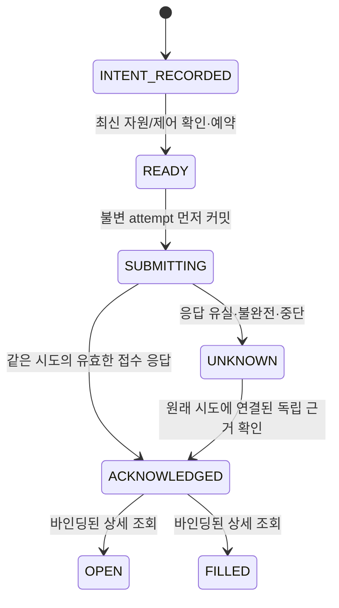

# 실제 주문 접수·전송·불확실 응답의 구현 계약

2026-11-17 설계, 2026-11-18 구현 범위 갱신. 사용자 승인으로 주문 연동 **코드 구현**은 허용됐다. [주문 writer](ORDER_WRITER.md)에 LIMIT+DAY·정수 수량 요청과 단일 전송/응답 처리를 구현했으며 production writer는 항상 비활성이다. 테스트는 가짜 통신과 `.invalid` 주소만 사용한다. 실제 주문 호출·실거래 활성화·배포·사용자 DB 마이그레이션은 승인되지 않았다. [주문 시도 영속 기록](ORDER_ATTEMPT_JOURNAL.md)은 전용 테스트 DB/mock 통신으로 추가했으며 실제 금융 원장/운영 gate는 후속 범위다.

## 확인한 공식 자료

공개 문서 GET만 수행했다. 키/토큰·계좌/주문 API는 호출하지 않았으며 원문 전체를 저장소에 복제하지 않았다.

| 원문                                                                            | 확인 version / SHA-256                                                      |
| ------------------------------------------------------------------------------- | --------------------------------------------------------------------------- |
| [REST OpenAPI](https://openapi.tossinvest.com/openapi-docs/latest/openapi.json) | 1.2.28 / `c5918961335ccd6b091577e307dc06ed505b58f83e4d99f0c4617de14ceb036a` |
| [AsyncAPI](https://openapi.tossinvest.com/openapi-docs/latest/asyncapi.json)    | 1.2.3 / `46669a360d4c5c6485c157624825e599f5dc55f8b9f66b9b3bcf3bfc3b9e7512`  |
| [연동 개요](https://openapi.tossinvest.com/openapi-docs/overview.md)            | `bef057d9babe9a389b78c430e7dfeaa6859cb09adf0e1906c3728a57c8972204`          |
| [FAQ](https://openapi.tossinvest.com/openapi-docs/faq.md)                       | `6ad4c02b8e785f7de1a067398736e69b546069f8d1e74d89e294a1a774c1a1da`          |

REST 원문은 이전 확인과 같았다. `/latest/`는 이후 바뀔 수 있으므로 실제 adapter 구현 직전에 다시 확인한다. 아래 원문 사실과 별도의 보수적인 클라이언트 정책을 구분한다.

## 접수·조회·정정의 핵심 차이

| 공식 명세에서 확인한 사실                                                                                                                                                                         | 구현 계약                                                                                                            |
| ------------------------------------------------------------------------------------------------------------------------------------------------------------------------------------------------- | -------------------------------------------------------------------------------------------------------------------- |
| 생성 요청의 clientOrderId는 선택적이며 10분 멱등 키다. 같은 키/내용은 기존 결과, 처리 중은 request-in-progress, 내용 변경은 idempotency-key-conflict다. 만료 후 같은 키도 신규 주문이 될 수 있다. | 우리 초기 profile에서는 필수·영구 비재사용. 10분을 자동 재전송 권한으로 쓰지 않음                                    |
| 생성 성공 result는 orderId와 선택적/nullable clientOrderId다. 상태/체결량은 없다.                                                                                                                 | 200을 OPEN/FILLED로 승격하지 않음. 원래 시도와 echo·주문 ID를 확인한 ACKNOWLEDGED까지만 기록                         |
| 주문 목록/상세의 Order에는 clientOrderId가 없고, 그 키를 받는 조회 query도 선언돼 있지 않다.                                                                                                      | 응답 유실로 orderId가 없으면 GET으로 키를 검색한다고 구현하지 않음. 종목/시각/수량으로 추정 연결 금지                |
| 정정과 취소의 OrderOperationResponse는 원주문과 다른 새 orderId다.                                                                                                                                | 원주문 ID·operation attempt·새 ID의 lineage를 보존. 취소 200/새 ID를 즉시 원주문 취소 완료/예약 해제로 취급하지 않음 |
| 목록은 앱/WTS 주문도 포함하며 일부 미지원 호가 유형은 조회되지 않는다.                                                                                                                            | 목록 존재가 전략 소유권은 아니며 부재/404도 미접수·취소/재전송 근거가 아님                                           |

clientOrderId는 최대 36자의 영숫자/`-`/`_`다. 향후 생성 profile은 영구 intent에 고정한 UUID 형태의 키를 사용하고, 통신 오류/재시작/전략 토글로 새 키를 만들지 않는다. 응답 echo가 누락/null/불일치하면 우리 엄격 profile에서는 미확인으로 둔다. 이는 공식 optional 필드를 임의로 필수 DTO라고 주장하는 것이 아니라 우리 연결 근거 요건이다.

## 전송 상태와 원장 상태

이 도표는 **운영 전송의 미래 경로**다. mock에서는 의도/단일 attempt/접수·미확인 결과 저장까지만 구현했으며 Paper 상태 enum/실행 권한을 변경하지 않는다. 접수 확인과 최초 금융 기준/체결 적용은 따로 커밋한다. 늦게 확인한 결과도 원래 attempt에 연결하며 다른 run/계좌/전략/키로 이전하지 않는다.

1. 실제용 별도 의도/영구 dedupe와 계좌·전략 revision·불변 경제 요청 hash를 저장한다. 합성 테이블/source/Paper 계좌를 재사용하지 않는다.
2. 계좌 행 잠금에서 최신 제어 epoch/처리 소유권·실제 자원/한도·미확인 주문·신호 중복을 검사하고 예약한다.
3. 요청 전체·고정 client key·계좌 문맥·소유 세대·version·최초 시각/기한을 포함한 단일 attempt를 커밋한다. DB transaction 안에서 HTTP를 호출하지 않는다.
4. 별도 승인된 writer만 해당 시도를 한 번 전송한다. 현재 GET transport의 자동 401/429/5xx 재시도를 POST에 재사용하지 않는다.
5. 원래 시도/계좌 문맥에 연결된 접수 근거를 CAS로 저장하고, 알려진 orderId의 읽기 전용 상세/목록으로 확인한다. 연결할 수 없는 결과는 UNKNOWN과 예약을 보존한다.

새 writer도 기존 worker가 소유한 같은 client/session의 token manager와 advisory lock을 사용해야 한다. API 서버/별도 broker 인스턴스가 독립 토큰을 발급하지 않는다. 인증/한도 구성 요소를 공유하되 GET의 재시도 루프와 POST 단일 시도는 분리하고, 토큰을 브라우저/IPC 응답에 내보내지 않는다.

전송 시작 후 timeout/취소·프로세스 중단·깨진 JSON/200·401/429/5xx만 보고 미접수로 판정하지 않는다. HTTP status만으로 원래 intent를 거절/중단하거나 예약을 해제하지 않는다. 특히 409 request-in-progress나 422 idempotency-key-conflict는 원래 주문의 미접수를 증명하지 않는다. 확정 거절 code/응답 근거의 whitelist는 writer 별도 작업에서 정한다.

정지/lease 교체는 신규 전송 claim을 막는 제어이며 이미 dispatching인 요청의 원격 효과가 없음을 보장하지 않는다. 미확인/in-flight 자료를 보존하고 정상 정리·재개·자동 취소로 표시하지 않는다. 재시작은 먼저 조회/대사 모드이며 SUBMITTING/UNKNOWN을 READY로 되돌려 자동 전송하지 않는다.

## 멱등 기간과 수동 검토

FAQ는 10분 안의 같은 요청 재전송을 안내하지만, **우리 기본 정책은 재전송 금지**다. 키만 같아도 만료 후 새 주문이 될 수 있고, 공개 GET에는 그 키로 확인하는 경로가 없다.

나중에 제한된 재전송을 허용하려면 별도 명시적 정책이 필요하다. 동일한 원래 요청/계좌/키, 영구 attempt, 아직 유효한 보수적 기한, 단일 소유자와 in-flight 정리·원문 불변을 검증해야 한다. 마감 시각·로컬 시계만으로 브로커의 실제 만료를 정확히 안다고 주장하지 않는다. 기간/처리/소유권이 불확실하면 수동 검토로 남기고 새 키·추정 matching으로 우회하지 않는다. 이번에는 재전송 기능/예외를 만들지 않는다.

## 최초 부분 체결과 실제 금융 기준

현재 [합성 금융 모델](SYNTHETIC_LEDGER.md)은 원래 pending/0 수량 바인딩과 명시적 known-zero 관측이 있어야 등록된다. 실제 주문은 첫 조회 전에 이미 부분/전량 체결될 수 있으므로 이 계약을 그대로 실계좌에 사용하지 않는다.

실제용 구현에는 다음 구분이 필요하다.

- 전송 전에 해당 intent의 **내부 미적용/기장 합계가 0**임을 영구 기록한다. 이것은 provider가 0 수수료/0 체결을 반환했다는 가짜 OrderObservation이 아니다.
- 원래 attempt의 유효한 접수 근거로 실제 orderId를 연결한 뒤 첫 실제 누적량과 내부 적용 합계를 비교한다. 다른 시도/과거 주문에 0 기준을 소급 부여하지 않는다.
- 현재 원격 금액/수수료/세금이 null이면 내부 0 기록으로 메우지 않는다. 원격 자료를 보존하고 미적용 상태로 둔다.
- 관측/적용 기준을 분리한다. 완전한 후속 자료를 사용할 때도 이전 gap을 덮지 않고 별도 검토/해소 이력을 연결한다. 실제용 gap 해소/보정 계약은 별도 구현이며 현재 합성의 삭제/skip 금지를 해제하지 않는다.

초기 실제 보유분은 수동 소유로 고정한다. 브로커의 전체 보유량/평균가나 현금 snapshot을 덮어써 내부 전략 수량/원가를 재생성하지 않는다. 외부 주문/입출금/현금 차이는 미배정·대사 대상으로 남기며 새 매매를 차단한다. 실제 부족액/수수료 환급/이미 매도한 원가 정정은 단순 실패/미체결로 바꾸지 않고 독립 회계 정책이 필요하다.

## 실제 자원·정산·스트림의 범위

- 기존 getBuyingPower와 이번 getSellableQuantity는 현재 브로커 자원 조회다. 전략 소유권/예약/리스크 승인은 별도다. 판매 가능 수량 응답에는 종목/시장 echo가 없어 반환 instrument는 검증된 호출 문맥이며 응답 자체의 신원 인증이 아니다.
- 실제 비용은 OrderExecution의 nullable 누적 commission/tax를 보존한다. 조회한 요율로 실제 청구액을 다시 만들지 않는다.
- OrderExecution.settlementDate는 단독 결제 완료 증거가 아니다. Transaction에는 settled가 있지만, 공개 Transaction shape에 orderId/clientOrderId 연결 필드는 없다. 종목/수량/날짜로 거래를 주문별 비용/정산에 자동 귀속하지 않는다. 실제 정산·주문 가능 현금과 내부 receivables 해소는 별도 대사 정책이 필요하다.
- 첫 전송 profile은 REST 확인을 사용한다. AsyncAPI 1.2.3의 personal:order에는 execution.filledAt이 없고 연결 밖 재전달 보장도 없다. 이를 REST Order로 그대로 파싱하거나 수신 시각을 체결 시각으로 채우지 않는다. WS는 후속 별도 입력 계약/REST 대사 후 연결한다.
- 공개 한도는 ORDER 10TPS, ORDER_HISTORY 5TPS, ORDER_INFO 6TPS(09:00~09:10 KST 3TPS)이나 현재 응답 헤더를 우선한다. 숫자는 권장 주문 빈도/운용 승인이 아니며 mock writer는 ORDER 초기 10TPS와 응답 헤더를 적용하며 POST 자동 재시도는 추가하지 않는다.

## 다음 별도 작업의 구체 범위

2026-11-18 구현 승인을 받았다. 1단계의 제한 profile·가짜 통신 검증을 완료했고 실제 전송은 닫혀 있다. 2단계의 의도/attempt·결과 영속 기록을 전용 테스트 DB와 가짜 통신으로 구현했다. 첫 누적 체결/실제용 금융 기준은 남아 있다. 코드 구현 승인은 실제 주문 실행/배포·사용자 DB 마이그레이션 승인이 아니다.

| 순서 | 구현 산출물                                                                | 완료 조건                                                                                                                                                                   |
| ---- | -------------------------------------------------------------------------- | --------------------------------------------------------------------------------------------------------------------------------------------------------------------------- |
| 1    | 실제용 접수 DTO와 단일 요청 adapter, 전송 기본 비활성                      | 공식 create oneOf 중 LIMIT+DAY/정수 수량의 제한 profile. client key 필수·정규화 요청/hash 고정·초과 정밀도 자동 절삭 금지·POST 자동 재시도 없음. 테스트는 가짜 fetch만 사용 |
| 2    | 실제용 의도/attempt·ACKNOWLEDGED/UNKNOWN 저장과 실제 금융 opening baseline | 전송 전 의도/기장 합계, 원래 시도/응답 echo·ID 연결, 첫 partial/filled·null 비용/응답 유실·재시작·rollback·중복 키를 전용 테스트 DB에서 검증                                |
| 3    | 운영 gate·읽기 전용 자원/계좌/정산 대사                                    | 기본 live 거부를 유지한 채 owner가 선택한 계좌/종목/한도·유효 구간·미확인 상태·중단/조회 복구를 검토할 수 있는 결과를 마련. 합성 자료를 승인 근거로 사용하지 않음           |
| 4    | 별도 명시적 실행 승인 후 제한된 실계좌 1회 검증                            | 승인된 종목/수량/예산에 한해 실행. 이 세션에는 포함하지 않음. 첫 실거래를 전략 수익성/상시 운용 승인으로 확대하지 않음                                                      |

실전 전략은 여전히 미확정이며 기존 이동평균은 검증용이다. 자동 전략/시장가/금액·소수점/조건주문·정정 체인은 초기 writer 범위에 넣지 않는다. 취소는 새 ID/원주문 대사 계약이 확정된 별도 후속 작업이고 Paper abort로 대체하지 않는다.
