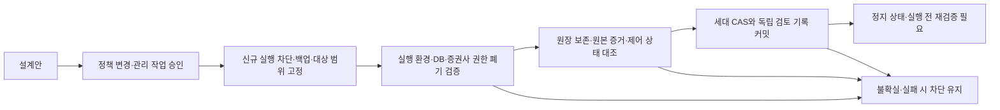

# Paper 구실행 권한 폐기 기반 정책 설계안

상태: **설계안·미구현·미적용**, 2026-11-10. 사용자 요청 범위는 새 정책안 설계다. 현행 AGENTS·closure·예약 검사와 a407 차단은 유지한다. [검토용 JSON](PAPER_AUTHORITY_FENCING_DRAFT.json)은 실행 입력이 아니며 이 형식을 받는 CLI/API는 없다.

## 안전 주장과 적용 범위

기존 closure는 “같은 run의 독립 종료를 검증했다”는 근거로 해당 예약만 처리한다. 새 안은 **권한 폐기 시점 이후 구실행이 보호 자원에 다시 접근할 수 없음을 검증**하는 별도 절차다. 과거 종료·미실행·체결·원장 정합성을 소급 증명하지 않는다. a407은 계속 과거 미검증이며 retired/성공으로 바꾸지 않는다.

대상은 실제 주문 기능이 없는 현재 읽기 전용·Paper 환경뿐이다. 실거래·주문 권한·새 전략 선정에는 적용하지 않는다. 소유자가 관리하는 승인된 프로그램의 잔존 실행·예약 재기동·캐시된 접속을 위협 범위로 잡는다. 관리자 권한으로 통제를 의도적으로 풀거나 증거를 위조하는 행위까지 방어하는 체계로 주장하지 않는다.

**추천 구조는 새 DB/빈 원장을 만드는 것이 아니라, 같은 보존 원장 위에서 관리 구간을 거쳐 실행 권한을 전환하는 방식**이다. 새 generation 번호나 디렉터리만 만드는 방식은 채택하지 않는다. 구프로세스가 새 코드를 실행하지 않아도 차단되는 외부 통제가 필수다. 새 분산 서비스·VM·빈 DB 도입을 지시하는 설계가 아니다. 먼저 현재 로컬 관리 환경이 필요한 통제와 독립 증거를 제공할 수 있는지 확인하고, 불가능한 부분을 소프트웨어 플래그로 대체하지 않는다.

## 반드시 함께 충족할 세 가지 폐기 근거

| 경계        | 필요한 근거                                                                                                                                | 충분하지 않은 것                                                           |
| ----------- | ------------------------------------------------------------------------------------------------------------------------------------------ | -------------------------------------------------------------------------- |
| 실행 환경   | 구 host/VM/container/service·예약·재시작 경로의 전체 범위와, 구워크로드를 다시 실행하지 못하게 하는 OS/관리 계층의 통제·확인               | PID가 안 보임, 현재 컨테이너 하나 중지, 재부팅 ID만 확인, 소유자 확인문    |
| DB          | 관련 Paper/토큰 잠금 DB의 구접속 자격 재사용 불가, 기존 세션/진행 트랜잭션 정리, 우회 접속·상속/관리 권한 점검, 새 자격의 구환경 노출 차단 | 비밀번호 또는 env만 교체, advisory lock 획득 1회, 계좌 stopped만 확인      |
| 증권사 접근 | 구 client 자격의 새 토큰 발급 불가와 기존 토큰/연결의 사용 불가를 포함한 제공자 측 통제 범위·효력 확인                                     | 새 토큰 1회 발급, 특정 옛 토큰 하나의 실패, TTL 예시 경과, IP 오류/timeout |

일부 호스트·복사본·자격의 범위를 알 수 없으면 scope-incomplete로 차단한다. a407에는 요청 바인딩이 없으므로 특정 KR 계좌만 대상으로 삼아 전체 구권한을 폐기했다고 판단할 수 없다. 범위를 넓혀 실제로 포괄했음을 확인하거나, 포괄할 수 없으면 이 안도 적용 불가다.

새 환경의 secret은 구빌드가 읽을 수 있는 기존 env 경로에 두지 않는다. 같은 UID·공유 volume·Docker 관리 소켓·예약 서비스 등을 통해 새 자격을 다시 얻을 수 있으면 격리 근거가 아니다. 구접속 권한을 되살리는 보상 작업을 자동으로 수행하지 않는다.

## 공식 자료로 확인한 사실과 미확인 사항

PostgreSQL의 CONNECT 권한은 접속 시작 때 검사된다. 따라서 신규 접속 차단과 기존 연결의 정리는 별도 확인 대상이다. 세션 종료 함수도 timeout 없는 true 반환은 신호 전송만 뜻할 수 있으므로 실제 세션 종료와 미완료 트랜잭션의 결과를 별도로 확인해야 한다. 이 설계에서 관리자의 세션 제어를 자동 실행하지 않는다. [접속 권한](https://www.postgresql.org/docs/17/ddl-priv.html), [세션 제어](https://www.postgresql.org/docs/17/functions-admin.html#FUNCTIONS-ADMIN-SIGNAL)

Toss 공개 OpenAPI는 client별 새 토큰 발급 시 이전 토큰 무효화를 설명한다. 하지만 구 client 자격이 살아 있으면 구프로세스의 재발급 가능성이 남으므로 이것만으로 fence가 성립하지 않는다는 것이 설계 판단이다. 확인한 Auth operation은 토큰 발급뿐이었다. WTS 키 재발급 설명은 있으나 키/클라이언트 회수가 모든 기존 토큰·연결·재발급 경로에 미치는 보장 범위는 이번 확인으로 확정하지 못했다. **그 보장을 추측해 endpoint나 자동 회수 명령을 만들지 않는다.** [공식 OpenAPI](https://openapi.tossinvest.com/openapi-docs/latest/openapi.json), [공식 FAQ](https://openapi.tossinvest.com/openapi-docs/faq.md)

실제 증권사 권한 폐기의 전체 범위를 공식 근거와 관리 계층에서 확인할 수 없다면 broker-fence-unverified다. 새 토큰 발급으로 이 상태를 성공으로 바꾸지 않는다. 공급자 권한 회수 기능의 지원 여부 확인과 실제 적용/효력 검증은 서로 별개이며 아직 수행하지 않았다.

## 상태 전이와 적용 순서

아래는 향후 구현할 절차이며 현재 동작은 아니다. 외부 통제는 DB 트랜잭션 하나로 묶을 수 없으므로 **새 실행 허용 기록을 마지막에 반영하고, 중간 실패는 관리 중지 상태로 남긴다.**

1. **정책 승인:** 현행 독립 exit만 허용하는 규칙에 어떤 별도 미래 실행 판정을 추가할지 먼저 승인한다. 설계 요청을 적용·권한 변경 승인으로 쓰지 않는다.
2. **관리 구간:** 새 관측/worker 시작을 막고 정확한 과거 파일 집합·원본 바이트 hash·누락 목록·현재 제어/원장 snapshot과 백업을 고정한다. 과거 request/exit는 만들지 않는다. 이미 대기 중인 소유 실행이 있다면 그 운영 절차를 먼저 따른다.
3. **범위 폐기:** 승인된 관리자 작업으로 위 세 경계를 모두 검증한다. 자기보고 JSON이 아니라 실제 통제 주체의 상태·효력·대상 바인딩과 검증 주체를 확인한다. 예상치 못한 접속 성공, 일부 실패, 증거 누락은 차단이다.
4. **원장 보존:** 기존 계좌·현금·통화별 손실과 날짜·소유권·원가·의도/체결/예약·영구 중복 키·설정/이력을 다시 읽어 비교한다. 권한을 폐기해도 Paper lease나 예약 행이 정리됐다고 추정하지 않는다. 열린 상태가 있으면 별도 승인된 기존 복구 절차가 필요하다. 행을 직접 삭제/수정해 맞추지 않는다.
5. **원자적 판정:** 대상 범위·원본 집합·권한 폐기 근거·전후 snapshot·승인된 제어 전이·기대 generation을 한 검토 묶음에 연결한다. 계좌 행 잠금/CAS와 독립 관리 전환 직렬화를 함께 설계해야 한다. CAS 실패나 상태 변화는 검토를 폐기하고 차단하며 자동 갱신/재시도하지 않는다.
6. **정지 상태 인계:** 모든 조건이 충족돼도 결과는 다음 실행의 검토 가능 상태뿐이다. 기존 코드 pin·새 선행 관측·15분·날짜/손실 검토·정지 시세·확정 봉·실행 승인·최대 60 tick·종료 대사를 별도로 요구한다.

부분 전환 실패에서 자동 rollback으로 옛 자격을 재활성화하지 않는다. 필요한 복구는 중지 상태에서 별도 관리자 작업으로 검토한다. 데이터 백업 복원과 실행 권한 복구도 구분한다.

## 증거 계약 초안과 신뢰 경계

실제 증거 포맷과 수집기는 아직 구현하지 않았다. 다음 항목을 필수로 하는 strict 계약을 향후 정의한다.

- 정확한 원본 run 집합/파일명·바이트 수/hash·누락 목록과 읽기 상한. 새/변경/삭제 파일·symlink·읽기 실패는 재차단.
- 전체 authority scope hash, 이전/새 generation, 기대 version/epoch, 정책/수집기/검증기 revision과 코드 hash.
- 세 경계 각각의 통제 주체·대상 바인딩·작업 시각/효력 구간·확인 경로·원천 증거 참조/hash. 일반 사용자 입력의 `revoked=true`만으로 검증하지 않음.
- 권한 전환 전후의 business ledger·제어/감사 delta·설정 hash, 승인한 변경만 존재한다는 검토 결과.
- 별도 정책 승인과 해당 관리 작업 승인의 범위/hash. 키·토큰·DB URL·계좌 번호·PID·원본 오류/관리 명령 출력은 응답·로그에 넣지 않음.

checksum은 내용 연결일 뿐 발급자의 진위나 실제 회수를 증명하지 않는다. 구환경과 같은 쓰기 주체가 임의로 만든 파일·자체 서명은 독립 근거가 아니다. 신뢰 가능한 통제 주체/수집 채널을 식별할 수 없으면 verifier는 unverified로 반환한다. 공급자/OS/DB가 이 증거를 제공할 수 있는지는 아직 확인하지 않았다.

권한을 다시 부여하거나 옛 실행을 재기동할 수 있는 관리 작업은 이 판정을 무효화하는 별도 사건이다. 단순 과거 파일의 성공 플래그를 계속 재사용하지 않는다. lease 획득 전·broker 연결 전·예약/체결 트랜잭션 경계에 적용할 재검증/지속적 통제는 향후 구현·검증 대상이다. 구빌드는 새 소프트웨어 검사를 호출하지 않으므로 외부 차단이 살아 있어야 한다.

## 현재 코드와의 변경 지점

| 지점                  | 현재 동작                            | 새 안에서 별도 검토할 변경                                                          |
| --------------------- | ------------------------------------ | ----------------------------------------------------------------------------------- |
| 예약 closure          | 같은 run의 독립 launch/exit 필요     | 그대로 보존. 새 정책 기록을 closure/retired로 위장하지 않음                         |
| 상태 조회             | rejected/unresolved와 과거 실패 표시 | 과거 집계 유지. 조회로 회수/전환/파일 생성하지 않음                                 |
| 미래 실행 gate        | unresolved가 있으면 감독기 거부      | 범위 전체가 폐기 근거로 덮였는지를 별도로 판정. unresolvedCount를 0으로 바꾸지 않음 |
| 새/다른 미확인 기록   | 전체 스캔에서 차단                   | 승인 묶음 밖의 한 건이라도 있으면 차단. UUID allowlist만으로 제외 금지              |
| 계좌 lease/epoch·risk | 계좌 행 잠금과 기존 CAS              | 그대로 유지하며 관리 generation 검증을 추가. READY를 체결 권한으로 쓰지 않음        |
| 비공개 자료/HTTP      | 고정 루트·owner/loopback             | 과거/새 세대 이력을 모두 조회. 새 root로 과거 미검증 자료 숨김 금지                 |

특히 현행 전용 DB URL은 `hth_test`를 고정하며 checkpoint scope에는 host/port/DB/role이 포함된다. 새 DB 역할이나 host로 옮기면 기존 continuation의 “asOf 외 전체 동일” 조건이 달라진다. URL 검증을 느슨하게 하거나 scope를 제거하지 않는다. 역할/주소 변경이 필요하면 기존 계좌를 보존하는 별도 이전 검토·명시적 scope 연결·테스트가 먼저이며 이번 설계만으로 승인하지 않는다. 같은 역할의 자격만 교체해도 기존 연결과 새 secret 노출 경계의 검증은 생략할 수 없다.

현재 a407과 새 정책의 연결 범위는 **미정**이다. 요청이 없다는 이유로 특정 자원에만 묶었다고 가정하지 않는다. 전체 권한 범위를 입증할 수 없다면 정책 구현 후에도 a407의 차단이 해소되지 않을 수 있다.

## 수용 검사와 완료 판정

향후 구현의 필수 회귀 항목은 다음과 같다. 합성 자료의 통과가 실제 권한 폐기 증거를 대신하지 않는다.

| 입력/사건                                                  | 필수 결과                                                   |
| ---------------------------------------------------------- | ----------------------------------------------------------- |
| 모든 근거 없음 또는 자기보고 hash만 있음                   | 차단                                                        |
| OS 통제만 있음, DB/증권사 불확실                           | 차단                                                        |
| DB 새 접속은 실패하지만 기존 세션이 남음                   | 차단                                                        |
| 새 토큰으로 이전 토큰만 교체, 구 client 발급 자격 유지     | 차단                                                        |
| broker 회수 문서/효력 범위 미확인 또는 일부 옛 자격 미포함 | 차단                                                        |
| 파일 hash/집합 변경·새 미확인 run·부분 쓰기·상한/시각 오류 | 차단                                                        |
| 원장/설정 불일치·열린 의도/활성 예약·lease 잔존·CAS 경합   | 차단, 초기화/임의 정리 금지                                 |
| 전환 도중 실패·재시작·오래된 승인·통제 복구/철회           | 차단, 옛 자격 자동 복원/재시도 금지                         |
| 독립 근거·범위·원장·승인·CAS가 모두 검증됨                 | 미래 실행 검토 가능, **정지·canResume=false·실거래 비활성** |

이번 완료 범위는 설계와 공개 기술 근거 확인뿐이다. 다음 개발은 **가짜 증거만 사용하는 비적용 검증기**다. 실제 collector·관리 명령·예약 예외·실행 연결은 붙이지 않고, 필수 근거 누락/부분 실패/범위/CAS/기록 보존 거부를 먼저 검증한다. 실제 권한 전환과 현재 지침/운영 gate 변경은 이후 별도 검토·승인·실환경 효력 검증이 끝나야 가능하다.

검증은 공개 문서/로컬 코드 대조, 설계 JSON의 hash·미적용/비활성 필드·필수 근거 공백 확인, Markdown 링크·포맷·diff 검사에 한정했다. 코드/DB 변경이 없어 전체·DB 통합 테스트를 재실행하지 않았다. 기존 1,112개 통과 기록은 이전 고정 설정 합성 검증의 결과이며 이번 설계의 실환경 효력 증거가 아니다.
