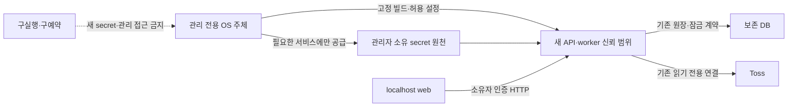

# 구실행과 새 비밀값의 실행 환경 분리 설계

상태: **설계·미구현·미적용**, 2026-11-10. [권한 폐기 정책](PAPER_AUTHORITY_FENCING_DESIGN.md)의 실행 환경 경계를 구체화한다. [증거 확보 검토](PAPER_AUTHORITY_EVIDENCE_FEASIBILITY.md)의 B 작업이며 기존 a407 차단·원장·예약·Paper 정지를 유지한다. 추적된 코드/설정과 공개 공식 자료만 확인했다. 현재 PC의 UID·예약·daemon/VM·실제 마운트·자격 범위는 수집하지 않았다.

## 설계 결정

**우선 분리할 단위는 API와 worker가 아니라 구실행 환경과 새 실행 환경이다.** 새 API·worker는 현행 IPC 호환성을 유지하는 하나의 신뢰 범위로 묶고, 그 범위를 관리하는 주체와 새 secret 공급 경로를 구실행에서 분리한다. web은 계속 비밀값 없이 정적 파일/HTTP만 처리한다. Fastify·worker 분리, PostgreSQL 원장, 로컬 Caddy 서빙은 유지한다. Redis·Vault·새 네트워크 gateway는 도입하지 않는다.

관리 전용 OS 주체가 실행 정의·daemon·예약·비밀값 원천을 통제하는 구성을 목표로 한다. 같은 PC에서 그 접근 경계를 입증할 수 있으면 별도 서버는 필요 없다. 현재 Docker Desktop/host 설정이 이를 제공하는지는 미확인이다. 계정 이름·Compose 프로젝트·컨테이너 UID만 바꿔 통과시키지 않는다. 별도 VM/서버는 현재 OS 경계로 통제가 불가능할 때의 대안이며 이번 설계로 생성하거나 이전하지 않는다.

## 관리 주체와 접근 행렬

아래는 목표 권한이다. 실제 사용자/역할 생성 명령이나 적용 가능한 Compose가 아니다. 새 실행의 관리자는 신뢰 대상으로 두며, 관리자 자체의 악의적 우회까지 막는 체계로 주장하지 않는다. 다만 구실행이 비대화식 sudo·Docker socket·관리 API·공유 자격으로 그 권한을 얻을 수 있으면 관리자가 분리된 것으로 보지 않는다.

| 주체                          | 새 실행 제어                                     | 새 secret                                                | 보존 원장/증거                                                              | 범위                                                      |
| ----------------------------- | ------------------------------------------------ | -------------------------------------------------------- | --------------------------------------------------------------------------- | --------------------------------------------------------- |
| 구실행·구예약·구복사본        | 금지                                             | 파일·env·백업·관리 채널 모두 금지                        | 활성 DB 접근은 외부 폐기 대상. 과거 자료 보유 자체를 없앴다고 주장하지 않음 | 현행 요청 누락 때문에 특정 계좌에만 범위를 한정할 수 없음 |
| 관리 전용 주체                | 명시적 관리 작업에서만 허용                      | 공급/회전·보관 허용                                      | 백업·범위 고정·독립 검증. 자동 재개 금지                                    | daemon/OS 정책·실행 정의·비밀값 원천의 소유자             |
| 새 API·읽기 전용 child worker | 자기 요청 처리만, daemon/OS 관리 금지            | 현행 조회 호환에 필요한 DB/Toss 설정, owner 해시는 API만 | 기존 owner/loopback·고정 root와 DB 작업 계약 유지                           | 현재 구현상 broker 발급 경로를 가진 신뢰 범위에 포함      |
| 새 상시 worker                | 자기 관측/정지 Paper 수명만, daemon/OS 관리 금지 | 필요한 DB/Toss 설정, owner 비밀번호/관리 secret 금지     | 기존 lease/epoch·행 잠금·출처 검사 유지                                     | 토큰/브로커 객체를 외부로 전송하지 않음                   |
| web/브라우저                  | 금지                                             | 금지                                                     | 허용 DTO만, DB/파일 직접 접근 금지                                          | 기존 localhost·소유자 인증 유지                           |

그림의 DB/Toss 연결은 목표 책임의 표시다. 현재 정책 차단·미확인 broker 회수·계좌 검토가 해결되지 않은 상태에서 실제 연결/재개를 허용한다는 뜻이 아니다.

## 현행 코드와 호환시키는 범위

[공유 IPC](../apps/worker/src/dashboard-sharing.ts)는 OS UID·0700 디렉터리·0600 socket을 확인하고 client ID/secret·DB URL·봉 주기로 주소를 계산한다. [API 설정](../apps/api/src/main.ts)은 시세 조회 활성 조건에 Toss/DB 설정을 요구하고, [조회 child](../apps/worker/src/dashboard-process.ts)는 공유 owner가 없을 때 기존 DB 잠금 아래 직접 broker를 만들 수 있다. 따라서 API에서 키만 제거하거나 UID만 나누는 변경은 현재 동작과 호환되지 않는다.

첫 전환에서는 새 API/worker끼리 같은 UID와 **새 실행에 한정된** IPC 볼륨을 유지한다. 컨테이너 UID가 과거와 같은 숫자여도 그 숫자 자체가 격리 근거는 아니다. 구실행의 host/daemon 권한·마운트·재생성 경로가 차단됐다는 외부 근거가 필요하다. 과거 IPC 볼륨/socket을 재사용하거나 남은 socket을 자동 삭제하지 않는다. 계좌/리포트 원본은 새 빈 디렉터리로 숨기지 않고 검증한 보존 자료로 인계한다.

후속 최소 권한 개선은 별도 변경이다. API의 키 요구/단독 발급 fallback, 비밀값 기반 IPC 범위 계산, UID 검사/허용 주체 인증을 함께 바꾸고 기존 단일 token owner·취소/drain·공개 DTO·불확실 실패 시 재발급 금지를 테스트해야 한다. 이 설계는 다른 UID를 허용하려고 socket을 0666으로 풀거나 인증 없는 TCP를 여는 방안을 채택하지 않는다.

[로컬 DB URL 조립](../packages/database/src/local-compose.ts)은 공통 비밀번호에서 고정 역할을 구성한다. 이번에는 별도 DB 역할/주소를 도입하지 않는다. 새 비밀번호 공급만으로 기존 접속/트랜잭션이 종료되지 않는다는 것은 [일회용 DB 실험](DATABASE_AUTHORITY_LAB.md)으로 재현했다. 구 API가 가진 관리 자격까지 대상에 포함하고 DB 관리 계층·볼륨을 구 daemon이 제어할 수 없는지도 확인해야 한다. 새 앱 경계만 분리하고 구환경에 DB 관리 권한을 남기는 것은 충분하지 않다.

## 비밀값 공급과 실행 정의

| 항목          | 목표 설계                                                                                                         | 채택하지 않는 대체                                                                      |
| ------------- | ----------------------------------------------------------------------------------------------------------------- | --------------------------------------------------------------------------------------- |
| 저장 원천     | 구실행이 읽거나 수정할 수 없는 관리자 소유 경로/접근 경계. repo·공유 app_data·옛 env 경로 밖에 둠                 | 기존 .env를 덮어쓰기, 세대별 파일명·0600만으로 같은 UID를 차단했다고 판단               |
| 공급          | 관리자가 검증한 빌드에 필요한 설정만 명시적으로 주입. owner 해시·DB 관리/일반 자격·Toss 설정의 수신자를 구분      | 관리 shell 전체 env 상속, 비밀값이 든 전체 env를 모든 서비스/child에 전달               |
| 파일형 secret | file loader를 별도 구현/검증한 뒤 서비스별 읽기 전용 공급. 공급원 host 접근과 컨테이너 안의 실제 권한을 모두 확인 | Compose secrets 선언만으로 host 파일·daemon 사용자·기존 프로세스 접근이 없어졌다고 판단 |
| 빌드/기동     | 키/환경/계좌 없는 고정 산출물과 관리자 소유 실행 정의. 구실행은 이미지/명령/volume/env를 교체할 수 없음           | 구실행이 쓰기 가능한 checkout/dist를 read-only로 마운트하고 무결하다고 판단             |
| 관리 접근     | 앱 컨테이너에 daemon socket·host 관리 socket·관리 secret·넓은 host 홈/루트 mount 금지                             | 컨테이너 user만 non-root로 바꾸거나 앱에 Docker 제어 권한을 주어 자체 폐기 검증         |
| 자료/백업     | 원장/과거 증거의 정확한 보존 집합과 읽기 권한을 별도 검토. 새 secret이 들어간 백업은 같은 관리 경계 안에 보관     | 과거 비공개 자료를 무검증 자동 복사하거나 새 secret을 과거 백업 경로에 노출             |

현재 앱에는 이 설계용 `_FILE` secret 입력을 구현하지 않았다. 이번에 환경변수를 파일로 자동 치환하지 않는다. Compose는 secret을 파일로 제공하지만 `file` 원천의 uid/gid/mode 재매핑을 보장하지 않으므로 host 권한과 실제 읽기 검사가 필요하다. 선언만 추가해 격리가 완료됐다고 표시하지 않는다. [Compose secrets](https://docs.docker.com/compose/how-tos/use-secrets/), [file 원천 권한의 제약](https://docs.docker.com/reference/compose-file/services/#secrets)

Docker daemon 제어자는 host 디렉터리를 mount하는 등 강한 권한을 가진다. rootless는 daemon과 컨테이너를 비관리 사용자/user namespace로 실행하는 기능이며, 구실행과 같은 사용자에게 그 daemon 제어를 남긴 채 새 secret만 숨기는 보장은 아니다. 이는 공식 기능에서 도출한 설계 판단이다. [daemon 보안](https://docs.docker.com/engine/security/), [rootless 경계](https://docs.docker.com/engine/security/rootless/)

## 같은 PC에서의 구성 선택

| 후보                                                 | 판단                                         | 확인할 조건                                                                                                                 |
| ---------------------------------------------------- | -------------------------------------------- | --------------------------------------------------------------------------------------------------------------------------- |
| 현재 사용자의 동일 daemon에서 새 프로젝트/UID만 사용 | 구실행 격리 근거로 채택 불가                 | 구 host 프로세스가 그 daemon/설정/volume을 제어하면 새 컨테이너의 권한 설정을 우회할 수 있음                                |
| 관리 전용 OS 주체가 통제하는 실행 계층               | 우선 검토할 목표                             | 구 UID의 관리 socket·공유 그룹·대체 관리 경로·새 secret 접근/재기동을 차단하고 범위 전체를 확인. 현재 PC 지원 여부는 미검증 |
| 관리 전용 VM/별도 서버                               | 위 조건을 같은 OS에서 제공할 수 없을 때 검토 | 구환경의 VM 관리·host 공유 폴더·원격 로그인/관리 키 접근까지 제외. DB scope 이전·자료 보존은 별도 검토                      |

새 Compose 프로젝트는 자료/서비스 충돌을 피하는 수단이지 관리 권한 격리 자체가 아니다. 현재 Caddy/API의 loopback 네트워크 수명 공유도 유지한다. 실제 host·DB 주소·role을 옮겨야 한다면 기존 checkpoint scope를 바꾸지 않는다고 주장할 수 없으므로, scope 연결/보존 이전 설계가 먼저다. 같은 원장을 보존하고 기존 validator를 완화하지 않는다.

## 전환 순서와 중단 조건

아래는 향후 별도 승인 작업의 순서다. 실행 명령·자동 적용기는 제공하지 않는다.

1. 구 host/daemon/VM·OS 주체·예약·복사본·실행 정의·자격/백업·DB/증권사 범위를 고정한다. a407의 누락된 요청을 추정 복원하거나 특정 계좌만 대상으로 좁히지 않는다. 하나라도 미확인이면 전환 불가다.
2. 관리 주체와 새 공급/빌드 경계를 가짜 자료로 검증한다. 실제 secret은 아직 공급하지 않는다. 구실행이 새 관리/DB 관리 권한을 되찾을 경로가 있으면 설계를 수정한다.
3. 관리 구간 진입·신규 시작 차단·검증된 백업/원본 기준 고정 후 승인된 수명 절차로 구작업을 정리한다. 강제 종료를 정상 종료 근거로 만들지 않는다.
4. 실행 환경·DB·broker 폐기 조건을 각각 확인한다. 기존 세션·준비 트랜잭션·새 토큰 재발급·기존 WS의 미확인은 차단이다. 새 token 발급이나 IP 변경만으로 전체 회수를 대신하지 않는다.
5. 구환경의 새 secret 접근과 재기동이 차단된 범위에만 새 자격을 공급한다. 새 실행은 idle/정지·resume=false이며 실제 관측도 별도 선택이다. 외부 증거·원장/원본 대조·기대 generation/version/epoch와 승인 바인딩을 재검증한다.
6. 최종 CAS·독립 검토 뒤에도 정지로 인계한다. 검증 중 관리 권한/범위/원본이 바뀌거나 외부 통제가 끊기면 다시 차단한다. 실패 시 옛 자격 자동 복원·예외 생성·재시도는 없다.

DB/Toss의 전체 폐기 근거가 없으면 이 실행 환경 설계가 완성돼도 운영 정책을 적용할 수 없다. 지금 공급자 문의를 보내거나 회수 작업을 수행하지 않았으며 공개 명세의 한계는 기존 검토를 따른다.

## 수용 검사와 구현 순서

| 검사/사건                                                           | 요구 결과                                                            |
| ------------------------------------------------------------------- | -------------------------------------------------------------------- |
| 구프로세스가 새 secret 파일/환경·백업·관리 socket에 접근            | 거부. 실패 원인이 확인되지 않은 timeout은 미검증                     |
| 구정의/예약이 새 secret 공급 대상으로 지정되거나 새 볼륨을 mount    | 관리 계층에서 거부. 앱의 generation if문만으로 대체 불가             |
| 구프로세스가 새 앱/DB daemon 제어 또는 대체 관리자 자격 획득 가능   | 전환 차단                                                            |
| 새 API·worker의 현행 공유 snapshot·단일 token owner·조회 취소/drain | 호환성 유지. token 전송/불확실 fallback 금지                         |
| 실제 자료 없이 fake secret으로 구/new container 읽기 경계 확인      | 실험 결과만 기록. host/daemon 전체 통제·provider 회수로 확대 금지    |
| DB 주소/역할·원본/원장·control 기준 변경                            | 기존 scope/CAS 검사로 차단. 별도 이전 검토 없이 재계산/초기화 금지   |
| 모든 설계/합성 실험 통과                                            | 설계 검토만 완료. operatingApproval/executionEnabled/canResume=false |

다음 구현은 **가짜 secret만 쓰는 일회용 파일/컨테이너 권한 실험**이다. 동일 UID/공유 mount의 부정 사례와 분리 mount/권한의 거부 사례를 먼저 재현한다. 그 다음 필요한 file loader와 기존 IPC 호환성 검사를 별도 변경으로 구현한다. 실제 OS 주체·daemon 권한 전환, broker 보장, DB scope 이전, 운영 증거/최종 gate는 각각 남은 작업이며 현재 설계나 실험을 적용 승인으로 쓰지 않는다.

## 이번 검증 범위

추적된 Compose·Dockerfile·DB URL 조립·API 활성 조건·worker 조회/IPC와 공식 Docker 문서를 대조했다. 문서 링크·표/행렬·Mermaid 구성·포맷·diff를 검토했다. 문서만 변경하므로 앱/DB 테스트를 다시 실행하지 않으며, 직전 DB 실험의 1,275개 통과 기록을 이번 실행 환경 격리의 실환경 증거로 사용하지 않는다. 서비스/이미지/볼륨·사용자/권한·자격/계좌·예약/원본 파일을 변경하지 않았다.
