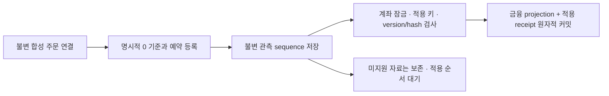

# 합성 누적 체결의 금융 원장 모델

2026-11-17 [주문 연결 저장](ORDER_BINDING_STORE.md) 다음으로 합성 관측을 현금·전략 수량·원가에 반영하는 순수 모델과 전용 DB 적용기를 구현했다. 모델은 `native-currency-unsettled-v1`이다. **실제 계좌/접수 인증·실제 주문/금융 원장·기존 Paper 체결을 구현하거나 활성화한 것이 아니다.**

## 책임과 코드

- [contracts](../packages/contracts/src/synthetic-ledger.ts): strict 합성 초기값·상태·등록·적용·효과 계약. 금액은 십진 문자열, 수량은 이번 모델에서 정수만 지원한다.
- [trading](../packages/trading/src/execution/synthetic-ledger.ts): initializeSyntheticLedger/registerSyntheticLedgerOrder/applySyntheticLedgerObservation과 상태 일관성 검사. Decimal precision 100, 외부 I/O/현재 시각 없음.
- [database](../packages/database/src/synthetic-ledger.ts): createSyntheticLedgerStore. `@hth/database/testing`에서만 공개하고 기본 앱·HTTP·CLI·worker/Paper 실행기에 연결하지 않는다.
- [0009](../packages/database/migrations/0009_synthetic_ledger.sql): 별도 네 테이블·복합 FK·고유 적용 키·불변 이력/초기값 트리거. 새 테스트 DB에만 적용한다. 기존 0000~0008/사용자 DB는 변경하지 않는다.

새 외부 라이브러리/서비스는 없다. 기존 합성 연결 저장소의 검증된 계좌 transaction을 패키지 내부 helper로 공유했다. raw transaction helper는 패키지 공개 entrypoint에 노출하지 않는다. 기존 연결 저장소의 공개 동작과 검사도 회귀 검증한다.

## 모델의 계산 정책

초기 자원은 명시한 KRW/USD 현금과 **수동 보유분**뿐이다. 초기 전략 수량·원가·미정산 금액·손익·주문을 주입하지 못한다. 초기/재초기화는 실제 계좌 조회나 자금 충전/재개가 아니다.

등록은 먼저 DB에 연결된 동일 계좌/의도의 불변 후보와 명시적 known-zero pending 관측을 요구한다. 0 체결량/금액/수수료/세금, null 평균가/체결 시각/정산 예정일·취소 없음이다. null 비용을 0으로 바꾸지 않고 이미 부분 체결인 최초 바인딩에 0 기준을 사후 부여하지 않는다. 현재 원장 등록은 바인딩의 원래 관측도 pending/0 수량이어야 한다.

예약 예산/수량은 합성 호출자가 명시한다. 매수는 자기 예약 현금, 매도는 자기 전략의 미예약 수량만 사용한다. 모든 주문의 같은 통화/전략 예약 합계를 함께 검사해 수동/타 전략 자원을 침범하지 않는다. 이 예약은 실제 buying power·리스크 승인·주문 권한이 아니다.

| 사건                               | 합성 효과                                                                                         |
| ---------------------------------- | ------------------------------------------------------------------------------------------------- |
| 매수 증가                          | 실제로 주어진 누적 대금/수수료/세금의 차이만 현금에서 차감. 해당 전략 수량·비용 포함 원가 증가    |
| 매도 증가                          | 해당 전략 수량/평균 원가만 해제. 순매도대금은 미정산 receivables에 적립하고 합성 실현 손익을 기록 |
| 부분 매도 원가                     | KRW 1원/USD 1센트 아래를 내림. 마지막 전략 수량 매도 때 남은 원가 전액 해제                       |
| 0효과/metadata                     | 신규 경제 효과 없이 관측의 적용 순서만 진행. 종료 확인 시 남은 예약 해제                          |
| 늦은 비용/환급·경제 정정           | 자동 배분/수량 환원 없이 검토 대상으로 미적용 유지                                                |
| 부족 자원·unknown·모순·미지원 정정 | 원본 관측을 지우지 않고 적용 차단. 다음 관측으로 미적용 구간을 건너뛰지 않음                      |

평균가×수량으로 대금을 복원하거나 차액÷수량을 개별 체결가로 저장하지 않는다. 금액이 통화 최소단위보다 정밀하면 몰래 반올림하지 않고 차단한다. 수수료/세금 요율을 새로 추정하지 않는다. KRW/USD를 환산하거나 다른 통화 현금/매도 예정 대금을 선사용하지 않는다.

이 모델의 현금/수량/미정산/평균 원가는 제한된 합성 가정이다. 실제 증권사의 매도 가능량·결제/주문 가능 현금·세금 원가·호가/시계·환전·거래일/일일 손익/평가 손익·상관 근거를 검증하지 않는다. realizedPnl은 통화별 합성 누적 실현 손익이며 일일 손실 한도/전략 성과가 아니다. 실제 부족액/정정·정산을 회계에 반영하는 정책은 별도 필요하다.

## 관측 저장과 적용의 분리

observe는 관측을 먼저 저장하고 `observedCount/observedHash`만 진행한다. 금융 상태의 version/현금/원가는 바꾸지 않는다. apply가 해당 binding의 바로 다음 sequence를 반영한 뒤에만 상태의 order.sequence가 진행한다. 순수 함수의 오래된/같은 sequence는 차단하며 DB의 기존 적용 키 조회는 **역사 receipt replay**다. 순수 계산만으로 영속적인 exactly-once를 보장하지 않는다.

| 테이블                        | 책임                                                                                                                                  |
| ----------------------------- | ------------------------------------------------------------------------------------------------------------------------------------- |
| synthetic_ledger_accounts     | 불변 초기 상태/hash, 현재 projection/hash/version. 실제/Paper 원장과 FK를 맺지 않음                                                   |
| synthetic_ledger_orders       | 같은 계좌의 합성 binding 복합 FK, 불변 등록/근거 hash·생성 version, 관측 수/head                                                      |
| synthetic_ledger_observations | 계좌+binding+sequence PK, 원본 정규화 관측/hash. 수정/삭제/재사용 금지                                                                |
| synthetic_ledger_mutations    | 계좌별 연속 version, register/apply, before/after hash·receipt/effect/hash. 계좌+binding+관측 sequence의 고유 적용 키 및 관측 복합 FK |

계좌당 32개 주문, 전체 관측/적용 512개로 제한한다. 상태 version은 등록 수+적용 수이며 최대 544다. 원래 소유 전략/revision과 수동 수량을 보존한다. 정정으로 다른 주문 ID를 자동 연결하거나 종료 후 재체결을 임의 보정하지 않는다.

## DB 메서드와 원자성

factory는 기존 합성 연결 저장소와 같은 localhost 전용 hth_readonly_test/hth_test·실제 pool URL을 검사하며 각 transaction에서도 실제 DB/역할을 확인한다. source는 synthetic-fixture뿐이다. 조회/factory는 마이그레이션·초기 자금/worker·관측·재개를 자동 수행하지 않는다.

- initialize: 등록된 합성 namespace/scope와 명시적 초기 자원을 확인한다. 같은 초기값 재호출은 현재 상태만 반환한다. 다른 현금/보유분으로 재초기화해 원장/손익을 리셋하지 못한다.
- register: 서버 DB의 원래 binding/의도/완전한 목록으로 순수 검사를 수행한다. caller의 proof는 받지 않는다. 같은 등록 원문 재조회는 원래 receipt를 반환하며 예산·기준을 바꾸지 않는다.
- observe: 해당 binding의 다음 sequence만 불변 저장한다. 같은 키/같은 내용은 replay, 같은 키/다른 내용은 충돌이다.
- apply: 저장된 관측/hash를 읽고 영구 적용 키를 먼저 확인한다. 이미 커밋됐으면 현재 CAS 값과 관계없이 원래 receipt만 반환한다. 다른 관측 hash로 재사용하지 못한다.
- read: 전체 필요한 이력과 projection을 검증해 서버 내부 합성 snapshot만 반환한다. 과거 receipt의 version을 현재 snapshot으로 오인하지 않는다.

모든 경로가 **합성 연결 계좌 행 → 금융 aggregate 행** 잠금 순서를 공유한다. 기존 연결/의도/이력과 금융 주문의 hash 연결, 초기/현재 상태의 schema/hash·자원 일관성, 관측 sequence/head, mutation version/hash chain과 적용 sequence·마지막 적용 원본 일치를 확인한다.

새 적용은 expectedVersion/expectedStateHash·expectedObservationHash를 확인한 뒤 순수 계산 결과의 projection, 새 mutation/receipt를 한 transaction에서 커밋한다. 중간 실패는 전체 rollback이고 원본 관측은 별도로 남는다. 자동 재시도·새 적용 키 생성·초기값 복구는 없다. DB 장애로 실패 시도 자체는 기록되지 않을 수 있다.

실패/미지원 관측을 새 내용으로 고쳐 쓰거나 미적용 sequence를 건너뛰는 override/resume/삭제 메서드는 없다. 비용 배분·부족액·정정 검토가 끝난 척 정상 완료로 바꾸지 않는다. 운영용 무제한/정산/보정 프로세스는 아직 제공하지 않는다.

raw SQL/오류·계좌/관측/현금/원가를 로그나 웹에 출력하지 않는다. 읽기 결과/receipt도 서버 내부 전용이며 실제 계좌 자료/자격을 받지 않는다. hash와 합성 acceptance 라벨은 제공자 진위나 계좌 소유권을 인증하지 않는다. DB 관리자 전체 재작성·실제 프로세스 crash/분산 exactly-once까지 검증했다고 주장하지 않는다.

## 권한과 검증

모든 결과/receipt의 ledgerApplied/ownershipVerified/evidenceAuthenticated/canApplyToLedger/executionEnabled/canResend/canResume는 false다. 순수 결과의 syntheticProjectionChanged와 DB의 stored는 **이 합성 모델의 상태/레코드 변경**만 뜻한다. 실제 또는 Paper 원장에 적용했다는 뜻이 아니다. 정상 검사·projection·read가 실행/재개 승인이 되지 않는다.

신규 순수 29개·DB 경계 4개·DB 통합 14개를 추가했다. 기존 연결 순수 76개·통합 24개를 포함한 관련 147개가 통과했다. 주요 검증은 다음과 같다.

- 0→2→3→5에서 효과 2/1/2와 총 5주/비용 포함 원가, 수동 10주 보존.
- 매도 원가/손익·미정산 분리·잔여 센트 원가 전액 해제, 수동/타 전략 및 타 예약 보호.
- 같은 적용의 두 pool 경합·응답 유실 뒤 재접속·역사 receipt 조회·최종 aggregate 저장 실패 rollback.
- 관측/적용 분리와 미적용 gap, 늦은 비용/원문 변경·사후 0 기준·재초기화 차단.
- 불변 SQL 이력·고유 적용 키·손상된 aggregate/journal 불일치, 기존 합성 연결 상태 보존.

재접속은 같은 테스트 프로세스의 새 DB pool이며 OS crash나 실제 증권사 장애 검증과 구분한다. 테스트는 실제 API를 호출하지 않고 새 전용 테스트 DB만 사용한다.

다음은 실제 주문 구현 전 접수 근거/전송 attempt·불확실 응답의 복구 계약과, 이 모델이 지원하지 않는 실제 비용/정산·부족액/정정 정책을 구체화하는 작업이다. 현재 live 거부·실제 주문 생성/정정/취소 금지는 그대로다.

최종 로컬 `verify:ci`는 새 일회용 localhost 전용 DB에서 **154파일·1,645개 테스트**를 통과했다(테스트 구간 77.19초). 포맷·린트·타입·전체 빌드·두 Compose 설정·문서 링크/diff도 통과했다. 원격 Actions/실제 계좌 운용 결과가 아니며 테스트 컨테이너는 소유 ID로 정리한다.

전체 검증 뒤 커밋 훅의 기존 테스트 4개는 PC 절전 구간에서 시간 초과로 실패했다. [검증 기록](CI_VALIDATION.md)의 전원 시각과 대조하고 동일 코드를 명령 수명 절전 방지로 재검사해 훅이 통과했다. 코드/timeout/검사 범위를 바꾸거나 실패를 무시하지 않았다.

후속 [실제 접수·전송 계약](ORDER_TRANSPORT_DESIGN.md)은 합성 known-zero 관측을 실제 최초 부분 체결에 재사용하지 않고, 전송 전 내부 기장 합계와 provider의 nullable 누적 값을 분리하는 다음 구현 범위를 정의한다. 실제 writer/실거래 권한은 추가하지 않았다.
